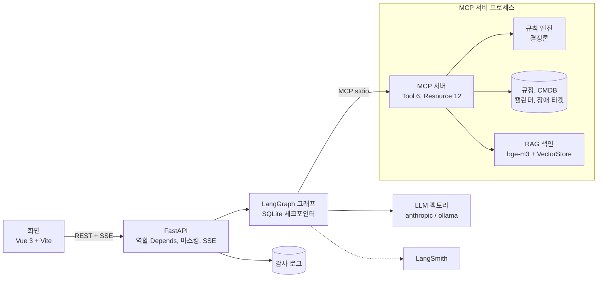
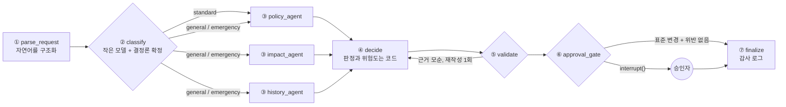

# GateKeeper

> **최종 보고서: [docs/REPORT.md](docs/REPORT.md)** (문제 정의, 구현, 시연 시나리오, 측정, 교훈)

인프라 변경요청을 사내 규정, 서비스 구성정보(CMDB), 변경 일정, 과거 이력과 대조해 위반과 위험을 찾고, 근거 조항을 붙여 승인/조건부/반려를 권고하는 에이전트다. **판정과 위험도는 결정론 규칙 엔진이 계산하고, LLM은 자연어 구조화와 설명, 조건부 대안만 맡는다.** 최종 결정은 변경관리자(사람)가 한다. SKALA AI Mini-Project 과제 2번(신규 프로젝트)이다.

| 문서 | 내용 |
|---|---|
| [docs/REPORT.md](docs/REPORT.md) | 최종 보고서 |
| [docs/DEMO.md](docs/DEMO.md) | 5분 발표용 시연 순서와 말할 포인트 |
| [docs/RESULTS.md](docs/RESULTS.md) | 최종 평가(eval 20건) 결과와 해석, 한계 |
| [docs/EVAL.md](docs/EVAL.md) | Before/After 평가 설계 (지표, 공정성 장치, 실행 방법) |
| [docs/SPEC.md](docs/SPEC.md) | 구현 명세 (그래프, 노드, MCP, API, 버전 플래그) |
| [docs/API_CONTRACT.md](docs/API_CONTRACT.md) | 화면과 서버 사이의 API 계약 |
| [docs/PROGRESS.md](docs/PROGRESS.md) | 단계별 진행 기록과 결정 기록 |

## 아키텍처



그래프 (v2). 정책, 영향도, 이력 서브에이전트는 컴파일된 서브그래프이고 병렬로 돈다. 표준 변경은 정책 검사만 거친다.



세 버전은 같은 코드베이스의 플래그(`GK_VERSION=v0|v1|v2`)다.

| 버전 | 구성 |
|---|---|
| v0 | LLM 단독 (규정, CMDB, 캘린더, 장애 티켓을 프롬프트로 제공). 기준선 |
| v1 | + 결정론 MCP Tool, 라우팅, 병렬 서브에이전트, 코드 판정 |
| v2 | + 이력 하이브리드 RAG, Validator (기본값) |

## 실행 방법

준비물: Python 3.11 이상, [uv](https://docs.astral.sh/uv/)(권장), Node.js 22 이상, [Ollama](https://ollama.com/)(이력 RAG 임베딩에 필요, 로컬 LLM을 쓰면 LLM도). Windows에서는 Git Bash로 `bash sh/...`를 실행한다.

```bash
# 1. 설치
git clone https://github.com/Taeyum/GateKeeper.git && cd GateKeeper
bash sh/setup_venv.sh            # .venv를 만들고 requirements.txt를 설치 (Python 3.11 고정)
cp .env.example .env             # 키를 채운다 (ANTHROPIC_API_KEY, 선택: LANGCHAIN_API_KEY). .env는 커밋하지 않는다
bash sh/setup_ollama.sh          # bge-m3(임베딩), qwen3 모델을 받는다. Claude만 쓸 때도 bge-m3는 필요하다

# 2. v2의 이력 RAG 색인 (이력 100건, 약 20초. 이력이나 임베딩 모델을 바꾸면 다시 만든다)
bash sh/build_index.sh

# 3. API 서버 (포트 8100)
LLM_PROVIDER=anthropic bash sh/run_api.sh    # Claude API (과금 확인 프롬프트가 나온다. GK_YES=1로 건너뜀)
LLM_PROVIDER=ollama bash sh/run_api.sh       # 로컬 Ollama

# 4. 화면 (http://127.0.0.1:5173). 다른 터미널에서
bash sh/run_web.sh
VITE_API_MOCK=1 bash sh/run_web.sh           # 백엔드 없이 목업 데이터로 화면만 확인
```

- provider와 모델은 환경 변수로만 바꾼다(`LLM_PROVIDER`, `MODEL_MAIN`, `MODEL_SMALL`, `MODEL_JUDGE`). 환경 변수 표는 [CLAUDE.md](CLAUDE.md)와 `.env.example`에 있다. 기본 모델은 anthropic이 `claude-sonnet-5-5`(구조화, 설명)와 `claude-haiku-5-5`(분류), ollama가 `qwen3:8b`와 `qwen3:0.6b`다.
- 시연 순서는 [docs/DEMO.md](docs/DEMO.md)에 있다. 요청 목록을 비우려면 서버를 끄고 `.data/checkpoints.sqlite*`와 `.data/audit.jsonl`을 지운다.

```bash
# 테스트
pytest -q                        # 976건 (실제 LLM 호출 테스트는 제외)
pytest -q -m llm                 # 실제 LLM 호출 테스트 (키와 Ollama 필요)
cd web && npm test               # 화면 단위 테스트 (vitest)

# 평가 (docs/EVAL.md)
python eval/run_eval.py --version v1 --split dev --reps 1 --provider anthropic
bash sh/run_final_eval.sh        # 최종 평가(eval 20건) 6개 실행을 순서대로. 결과는 .data/final_eval
python eval/report.py --split eval --provider anthropic --out results/report_eval_anthropic.md --charts-dir results/charts_eval_anthropic
```

## 디렉터리

```
README.md, CLAUDE.md          개요, 작업 규칙과 환경 변수 표
app/
  rules_engine/               결정론 규칙 엔진 (조항당 파일 하나: chg01.py ~ chg10.py, 긴급, 표준 변경, 위험도, 판정)
  mcp_server/                 FastMCP 서버: Tool 6개, Resource 12개 (규정 원문)
  agent/                      LangGraph 그래프와 노드 (노드당 파일 하나), 프롬프트(prompts/), MCP 클라이언트
  rag/                        이력 RAG: 임베딩, 벡터 저장소(VectorStore), 색인
  api/                        FastAPI: 엔드포인트 6개, SSE, 역할 확인, 마스킹 미들웨어, 요청 저장소
  llm/                        LLM 팩토리(provider별), 가짜 모델(테스트), 사용량 집계
  persistence/                SQLite 체크포인터 (사람 승인 대기가 재시작을 견딤)
  config.py, schemas.py,      설정, 도메인 스키마(Pydantic), 비밀값 마스킹, 감사 로그, 데이터 로더
  masking.py, audit.py ...
eval/                         평가 하네스, 지표, LLM-as-Judge, 리포트와 차트, LangSmith 연동
scripts/                      RAG 색인 빌드
sh/                           실행 스크립트 (setup, run_api, run_web, build_index, run_final_eval)
web/                          화면 (Vue 3 + Vite + TypeScript), 목업 API(mock/), 테스트(tests/)
tests/                        pytest (조항별 경계값, 그래프, MCP, API 통합, 평가 하네스 등)
gatekeeper_data/              가상 데이터: 규정 원문(rules/), CMDB, 캘린더, 장애 티켓, 이력(data/), 정답 라벨(eval/)
results/                      평가 summary(json), 리포트(md), 차트(png). 요청별 jsonl은 git 제외
docs/                         보고서, 명세, 평가 설계, 진행 기록, 단계별 보고(reports/), 계획(plans/)
```

## 평가 요약

같은 정답셋(eval 20건)과 같은 지표로 세 버전을 쟀다. 자세한 표와 해석, 한계는 **[docs/RESULTS.md](docs/RESULTS.md)**, 설계는 [docs/EVAL.md](docs/EVAL.md)다. 두 축은 모델이 달라 서로 비교하지 않는다.

| 축 | 지표 | v0 | v1 | v2 |
|---|---|---|---|---|
| Claude Sonnet 5.5 (3회 반복) | 판정 정확도 | 100.0% | 100.0% | 100.0% |
| | 위험도 일치 | 88.9% | 88.9% | 100.0% |
| | 지연 평균 / 요청당 비용 | 10.4초 / $0.044 | 14.2초 / $0.048 | 18.6초 / $0.068 |
| 로컬 qwen3:4b (1회) | 판정 정확도 | 35.0% | 75.0% | 70.0% |
| | 위험도 일치 | 22.2% | 88.9% | 88.9% |
| | 지연 평균 | 10.3초 | 62.3초 | 101.5초 |

- **약한 모델에서는 구조의 효과가 크다.** 판정을 코드로 옮긴 v1이 정확도를 35.0%에서 75.0%로 올렸다. 대가는 지연 약 6배다.
- **강한 모델에서는 LLM 단독도 정확도가 포화한다.** 구조가 더한 측정 가능한 이득은 v2의 위험도뿐이고, 대가는 지연 +79%와 비용 +54%다.
- 모델 축(qwen3:4b)은 dev에서 Sonnet이 포화하는 것을 본 뒤에 더한 **사후 축**이라 그 개선폭을 구조 일반의 효과로 읽지 않는다.

## 한계

- 강한 모델에서는 정확도와 3회 반복 일관성이 포화해서 구조의 효과가 정확도로는 보이지 않는다. 구조의 가치는 감사 가능성(조항별 근거, trace, 감사 로그)과 이력 기반 위험도에 있다.
- 입력 구조화가 틀리면 코드도 틀린 입력으로 판정한다. 약한 모델에서 시각 구조화 정확도가 25~45%였다. 구조화 시각과 원문 날짜 표현을 대조하는 방어는 아직 없다.
- 구조의 대가는 지연과 비용이다. LLM 호출이 1회에서 약 7회로 늘고, 로컬 모델에서는 평균 지연이 10.3초에서 62.3초(v1), 101.5초(v2)로 늘었다(v2 값에는 600초 제한에 걸린 요청 1건이 들어 있다).
- 평가 규모가 작다(dev 10건, eval 20건). 수치 차이를 통계적 결론으로 읽지 않는다. Claude 5.5는 temperature를 고정할 수 없어 3회 반복 일관성을 따로 쟀다.
- 측정 지점은 사람 승인 직전이다. "자동 승인은 표준 경로에서만" 같은 승인 단계의 안전장치는 평가 수치에 들어 있지 않다.
- 규모 가정: 이력 100건이라 평면 색인을 썼고 요청 목록은 메모리와 체크포인터로 관리한다. 화면 문구의 숫자(30일, 24시간)는 화면에 고정돼 있어 규정이 바뀌면 같이 고쳐야 한다. 데이터는 가상이다.

## Base 프로젝트에서 참고한 부분과 새로 만든 부분

강사가 제공한 Base 프로젝트(인시던트 분석 에이전트)는 이 저장소에 복사하지 않았고 밖에서 참고만 했다. 코드와 화면은 새로 만들었다.

**참고한 부분 (방식만 참고, 코드는 새로 작성)**

| 부분 | 참고한 것 | 이 프로젝트에서 달리한 것 |
|---|---|---|
| 실행 스크립트 형식 | `sh/` 스크립트의 모양: 환경 변수로 provider 선택, 시작 전 점검, 안내 박스, 종료 방법 안내 | 과금 provider 확인 프롬프트(`GK_YES=1`로 건너뜀), Windows(Git Bash) 대응, 색인과 키 점검, 최종 평가 스크립트 |
| SSE 이벤트 처리 방식 | 서버가 진행 이벤트를 흘리고 화면이 구독해 단계별로 그리는 방식 | 요청별 이벤트 기록과 replay, 끊긴 뒤 재연결과 상태 복구, 그래프 실행은 연결과 무관하게 계속, 계약 문서(`docs/API_CONTRACT.md`) 기준 이벤트 |
| LLM 설정 방식 | provider와 모델을 환경 변수로 고르는 방식 | 팩토리 한 곳에서만 LLM 생성, anthropic은 temperature 미전송, 구조화 출력용 와이어 스키마 |
| MCP 클라이언트 구조 | 서버를 자식 프로세스(stdio)로 띄우고 Tool을 호출하는 구조 | 호출을 Lock으로 직렬화하지 않고 병렬 호출 지원, 자식 프로세스에 API 키 환경 변수를 넘기지 않음, 호출마다 타임아웃과 제한된 재시도, `NOT_FOUND` 같은 오류 계약 |
| 데이터의 서비스 이름 | Base와 맞춤(payments-service 등) | 데이터 내용(규정, CMDB, 캘린더, 이력, 정답 라벨)은 이 프로젝트용 가상 데이터 |

**새로 만든 부분**

- 문제 영역과 설계: 변경요청 검토, "판정은 코드, 해석은 LLM" 원칙, v0/v1/v2 Before/After 평가
- 결정론 규칙 엔진(조항 10개, 긴급 변경, 표준 변경, 위험도, 대안 일정 탐색)과 규정 원문 기반 MCP Resource/Tool
- LangGraph 그래프: 컴파일된 서브에이전트 3개의 병렬 실행, 라우팅, Validator의 재작성 루프, 사람 승인(`interrupt()`와 SQLite 체크포인터)
- 이력 하이브리드 RAG(메타데이터 일치 + 벡터)와 코드로 정하는 위험도 상향
- FastAPI(역할 확인, 마스킹 미들웨어, 감사 로그)와 화면(요청자: 입력, 진행, 결과, 고치기 안내 / 승인자: 위험도 순 결재함)
- 평가 하네스(지표, LLM-as-Judge, 공정성 장치, LangSmith, 리포트와 차트)와 최종 평가 결과
