# GateKeeper 최종 보고서

**인프라 변경요청을 규정과 대조해 승인/조건부/반려를 권고하고, 최종 결정은 사람이 내리는 에이전트**

| 항목 | 내용 |
|---|---|
| 소속 | SKALA 4기 광주 2반 |
| 고유번호 / 이름 | G056 / 은태현 |
| 과제 | AI Mini-Project 과제 2 (신규 프로젝트) |
| 소스 코드 | https://github.com/Taeyum/GateKeeper |
| 기획서 | https://claude.ai/artifact/A2wCJ4PCuyHxVVejJ9ErEW |
| 화면 디자인 | https://claude.ai/artifact/8W4pp3cmUCZP6cRXdAhe35 |

---

## 0. 한눈에 보기

- **문제**: 변경관리자는 매일 자연어로 쓴 변경요청을 읽고, 규정, CMDB, 변경 일정, 장애 이력을 화면 네 개에서 맞춰 보며 위반을 찾는다. 금요일 저녁 배포나 DB 포트 외부 노출 같은 위반이 사람의 눈을 지나치면 장애가 된다.
- **해결**: LLM은 자연어를 구조화하고 설명과 조건부 대안을 쓴다. **판정과 위험도는 결정론 규칙 엔진(MCP Tool)이 계산**한다. 정책, 영향도, 이력 서브에이전트가 병렬로 근거를 모으고, Validator가 근거를 검증하고, 승인자가 최종 결정한다.
- **결과**: 같은 정답셋과 같은 지표로 v0(LLM 단독), v1(+Tool, 병렬 서브에이전트), v2(+이력 RAG, Validator)를 비교했다.

최종 평가 (eval 20건, 개발 중 한 번도 보지 않은 정답셋)

| 로컬 소형 모델 qwen3:4b (1회) | v0 | v1 | v2 |
|---|---|---|---|
| 판정 정확도 | 35.0% | **75.0%** | 70.0% |
| 위반 조항 F1 | 32.0% | **66.7%** | 61.1% |
| 위험도 일치 | 22.2% | **88.9%** | 88.9% |
| 판정과 자기 위반 목록의 모순 | 15.0% | **0%** | 0% |
| 지연 평균 (대가) | 10.3초 | 62.3초 | 101.5초 |

| Claude Sonnet 5.5 (3회 반복) | v0 | v1 | v2 |
|---|---|---|---|
| 판정 정확도 / 3회 일관성 | 100% / 100% | 100% / 100% | 100% / 100% |
| 위험도 일치 | 88.9% | 88.9% | **100%** |
| 지연 평균 / 요청당 비용 (대가) | 10.4초 / $0.044 | 14.2초 / $0.048 | 18.6초 / $0.068 |

- 약한 모델에서는 판정을 코드로 옮긴 구조(v1)가 정확도를 두 배로 올렸다. 대가는 6배의 지연이다.
- 강한 모델에서는 LLM 단독도 정확도가 포화됐다. 구조가 더한 것은 이력 RAG의 위험도(v2)였고, 대가는 지연 79%와 비용 54% 증가다.
- 자세한 표와 해석은 [5.4절](#54-beforeafter-측정), 한계는 [6.1절](#61-한계와-트레이드오프)에 있다.

---

## 1. 문제 정의와 해결 과제

### 1.1 기존 방식의 문제

| 역할 | 지금 겪는 문제 |
|---|---|
| 요청자 (운영 엔지니어) | 규정이 위키, 메일, 회의록에 흩어져 있어 제출하고 반려받은 뒤에야 위반을 안다. 반려 사유가 한 줄이라 무엇을 고쳐야 통과되는지 다시 물어야 한다. |
| 승인자 (변경관리자) | 한 건을 보려고 요청서, CMDB, 변경 캘린더, 장애 이력을 따로 연다. 무난한 요청 수십 건 사이에서 위험한 한 건이 묻힌다. 승인 근거가 흩어져 사고 뒤 설명이 어렵다. |
| 운영팀장 (구매자) | 변경이 큰 장애의 주요 원인인데 검토 인력은 늘릴 수 없다. ISMS-P 2.9.1(변경관리) 심사 때마다 증적을 손으로 모은다. |

근거가 된 실제 사례: KT 전국 통신 장애(2021, 승인 시간과 다른 작업과 검토 누락), Uptime Institute 2025(사람 실수로 난 큰 장애의 85%가 절차 미준수나 절차 결함), ISMS-P 인증기준 2.9.1(변경 전 영향 분석 요구). 자세한 장면과 출처는 기획서에 있다.

### 1.2 해결 과제

1. 자연어 요청을 규정 검사가 가능한 구조로 바꾸고, 빠진 필수 항목을 바로 알려 준다.
2. 확실하게 판정할 수 있는 위반(시간대, 출발지 대역, DB 포트, 동결 기간, 기한)은 **코드로** 판정하고 근거 조항을 붙인다.
3. 영향 범위와 과거 유사 장애를 한 화면에 모아 승인자가 위험한 요청에 집중하게 한다.
4. 반려할 때는 통과 가능한 조건부 대안을 준다. 최종 결정은 사람이 하고, 그 기록이 감사 증적이 된다.
5. 개선의 효과를 같은 입력, 같은 지표로 **수치로** 보인다.

### 1.3 왜 규칙 엔진만이 아니라 에이전트인가

규칙 엔진은 정형 입력이 있어야 돈다. 실제 요청은 "주말 잠깐", "외부에서 접근 가능하게" 같은 자연어로 온다. LLM은 사람이 하던 **해석과 설명**(구조화, 조건부 대안, 유사 사례 요약)을 맡고, **판정**은 코드가 맡아 일관성과 감사 가능성을 지킨다.

---

## 2. 구현한 핵심 기능

| # | 기능 | 하는 일 | 구현 |
|---|---|---|---|
| F1 | 요청 구조화 | 자연어를 `ChangeRequest`(대상, 유형, 시각, 출발지, 포트, 기한, 롤백, 증적, 긴급 티켓 등)로 바꾼다. 필수 항목(작업 시각, 대상)이 비면 1회 다시 묻는다 | LLM 구조화 출력 + Pydantic 검증 |
| F2 | 유형 라우팅 | 표준 변경은 정책 검사만, 일반/긴급은 전체 검토. 애매하면 전체 검토(fail-safe) | 작은 모델 1차 분류 + 결정론 확정 + 조건부 엣지 |
| F3 | 규정 위반 탐지 | CHG-01~10 판정, 긴급 변경 면제(CHG-07) | 결정론 규칙 엔진 + MCP Tool, 규정 원문은 MCP Resource |
| F4 | 영향도 분석 | 서비스 등급, 담당 팀, 의존 서비스, 같은 시간대 변경 | MCP Tool(CMDB, 캘린더) |
| F5 | 과거 이력 검토 | 유사 장애 사례 제시, 같은 서비스 + 같은 유형 장애가 있으면 위험도 한 단계 상향 | 하이브리드 RAG(메타데이터 일치 + 벡터) |
| F6 | 병렬 검사 | 정책, 영향도, 이력을 동시에 실행하고 합친다 | LangGraph 컴파일된 서브그래프 3개 fan-out/fan-in |
| F7 | 권고와 근거 검증 | 판정과 위험도는 코드, 설명과 조건부 대안은 LLM. 대안 일정은 엔진으로 다시 검사 | Validator(코드 검사 + LLM 일관성 검사), 재작성 1회 한도 |
| F8 | 사람 승인과 감사 | 표준 변경은 자동 승인, 나머지는 승인자 결재까지 대기. 서버가 재시작돼도 대기 요청이 남는다 | `interrupt()` + SQLite 체크포인터, 감사 로그 JSON Lines |
| F9 | 화면과 실시간 진행 | 요청자: 입력, 단계별 진행, 결과와 고치기 안내. 승인자: 위험도 순 결재함, 상세, 결정 | Vue 3 + FastAPI SSE |
| F10 | 관측과 평가 | 버전별 Before/After, 요청별 trace | 평가 하네스, LLM-as-Judge, LangSmith |

판정 기준 (규정 1장)

| 판정 | 조건 |
|---|---|
| 반려 권고 | 금지 조항 위반 1개 이상: CHG-01 배포 금지 시간대(금 18:00~월 09:00), CHG-02 전체 대역 오픈, CHG-03 DB 포트 외부 노출, CHG-06 동시간 변경, CHG-10 배포 동결 기간 |
| 조건부 승인 권고 | 금지 위반 없이 보완 조항만: CHG-04 롤백 계획, CHG-05 Tier-1 24시간 전 요청, CHG-08 테스트 증적, CHG-09 외부 허용 기한(최대 30일) |
| 승인 / 자동 승인 | 위반 없음. 표준 변경(STD-01 로그 레벨, STD-02 인증서 갱신)은 자동 승인 |

위험도는 판정을 바꾸지 않고 결재 순서와 강조에만 쓴다(규정이 법조문, 이력은 판례).

---

## 3. 적용 기술 요소

### 3.1 Multi-Agent와 LangGraph

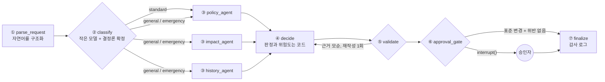

- **전문 서브에이전트 분리**: 정책, 영향도, 이력 에이전트는 각자 자기 상태 스키마와 내부 노드를 가진 **컴파일된 서브그래프**다(예: 정책은 `check_policy` → `read_rules` → `write_notes`). 부모 그래프에는 상태를 변환하는 래퍼로 붙고, LangSmith에서 부모 아래 병렬 중첩 trace로 보인다.
- **라우팅**: `classify`가 조건부 엣지로 경로를 정한다. 작은 모델의 1차 분류와 엔진의 확정값이 다르면 전체 검토로 보내고 "분류 불일치" 경고를 붙인다. 엔진 확정값은 지우지 않아 작은 모델의 실수가 판정으로 새지 않는다.
- **동적 재계획**: `validate`가 근거 모순을 찾으면 사유를 붙여 `decide`로 되돌린다(최대 1회, 루프 가드). 두 번째도 실패하면 "근거 검증 미완료" 경고를 달고 사람에게 넘긴다.
- **Supervisor를 LLM 계획으로 두지 않은 이유**: 필수 검사를 LLM 재량에 맡기면 빠뜨릴 수 있고 실행마다 계획이 달라진다. 세 검사의 호출은 메인 그래프가 코드로 강제한다(권위 게이트).

### 3.2 MCP

| 구분 | 내용 |
|---|---|
| 서버 | FastMCP(stdio). 에이전트와 별도 프로세스로 한 번 띄워 재사용한다 |
| Tool 6개 | `check_policy`, `check_window`(대안 일정 검증), `get_service_info`, `get_calendar`, `get_incident`, `search_history` |
| Resource 12개 | `rules://index`, `rules://CHG-01` ~ `rules://CHG-10`, `rules://standard`. 규정 원문을 조항 단위로 나눠 제공 |
| Resource와 Tool을 나눈 기준 | Resource는 호출해도 늘 같은 정적 문서(규정 원문), Tool은 입력에 따라 계산하거나 조회하는 동적 행위 |
| 오류 계약 | 없는 대상은 빈 결과가 아니라 `NOT_FOUND`, 입력 오류는 `INVALID_ARGUMENT`. 대상 오타가 "충돌 없음"으로 읽히지 않게 하는 fail-safe. 예상 못 한 내부 오류는 상세를 가린다 |
| 클라이언트 | 호출마다 타임아웃, 일시 오류만 지수 백오프 재시도(최대 2회), 병렬 호출 지원, 자식 프로세스에 API 키 환경 변수를 넘기지 않음 |

고객사마다 규정과 CMDB가 다르면 Resource와 MCP 서버만 바꿔 끼우면 된다.

### 3.3 RAG

- **임베딩**: bge-m3(로컬 Ollama). 과거 변경/장애 이력 100건의 제목과 설명을 색인한다.
- **저장소**: `VectorStore` 인터페이스(add, search) 뒤에 numpy 평면 색인을 주입했다. 100건은 전수 코사인 검색이 근사 오차 0이고 의존성이 없다. 수만 건 이상이면 Chroma나 pgvector 구현으로 클래스 하나만 바꾼다.
- **하이브리드 검색**: 같은 서비스 + 같은 유형의 이력을 메타데이터로 먼저 찾고, 남는 자리를 의미 검색으로 채워 상위 3건을 제시한다.
- **판정과의 경계**: 위험도 상향 여부는 검색 순위가 아니라 이력 전체에서 코드가 정확히 판단한다. 검색은 사례를 보여 주고 설명을 보강하는 데만 쓴다.
- **측정**: dev 정답 유사 이력 기준 RAG 재현율@3 100%(5/5).

### 3.4 아키텍처와 코드 품질

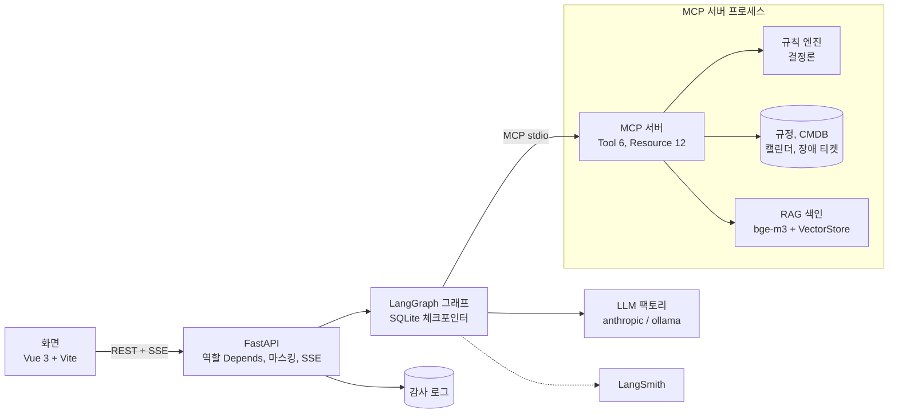

- **모듈화**: `rules_engine`(조항당 파일 하나), `mcp_server`, `agent/nodes`(노드당 파일 하나), `rag`, `api`, `eval`로 나눴다. 규정 값(시간대, 포트, 기한, 등급)은 코드에 쓰지 않고 `rules.json`과 데이터 파일에서 읽는다.
- **의존성 주입**: `build_graph(version, mcp=...)`, `create_app(mcp=..., checkpoint_path=...)`, `VectorStore`/`Embedder` 프로토콜, provider별 LLM 팩토리. 테스트는 메모리 MCP 서버, 가짜 LLM, 임시 SQLite를 주입한다.
- **단위 테스트**: pytest **976건**(실제 LLM 호출 테스트는 별도 마크). 조항별 경계값(금 17:59~18:00 통과, 18:01 위반, 정확히 24시간 전 통과, 30일 통과와 31일 위반 등), 공유 인터페이스 시그니처 고정, 평가용 그래프 구조 불변, API 통합(승인 흐름, 403, 서버 재시작 후 이어서 승인)까지.
- **규칙 엔진 차분 검사**: 규정 문서만 보고 따로 짠 판정기와 엔진을 무작위 요청 10,000건으로 비교해 불일치 0건을 확인했다. 2단계 리뷰에서 한 번 실행한 검사이고 결과는 `docs/handoff/feedback.md`에 기록돼 있다. 재실행 코드는 저장소에 없다.

### 3.5 관측 가능성과 평가

- **LangSmith 트레이싱**: 평가 실행마다 프로젝트(`gk-<버전>-<split>-<시각>`)로 노드 단위 trace를 남긴다. API 요청의 trace_id는 감사 로그와 같아 "왜 이렇게 판정했나"를 trace로 거슬러 올라갈 수 있다.
- **LLM-as-Judge**: 조건부 대안 품질을 1~5점으로 채점한다(위반 해소, 새 위반 없음, 구체성). 최종 평가의 Judge는 시스템 모델(Sonnet)과 다른 Opus를 써서 자기 채점을 피했다.
- **평가 설계**: dev 10건은 튜닝용, eval 20건은 최종 측정에만 쓴다. eval 정답은 개발 세션이 읽지 못하게 네 겹으로 막았다(개발 중 git 제외, 읽기 금지 설정, 코드의 로드 가드, 세션에 첨부하지 않음). 최종 측정 직전에 정답 파일을 저장소에 커밋해, 누구나 같은 정답으로 다시 잴 수 있다. v0에도 규정, CMDB, 캘린더, 장애 티켓을 모두 넣어 "정보를 안 줘서 틀렸다"는 반박을 막았다.
- **지표**: 판정 정확도, 위반 조항 P/R/F1, 구조화 필드 정확도, 환각/오인용 조항 수, 판정과 위반 목록의 자기모순, 위험도 일치, 긴급 판정, RAG 재현율@3, 3회 반복 일관성, 대안 품질, 지연 평균/p95, 토큰, 호출 수, 예상 비용, Validator 재작성.
- **공정성 장치**: 같은 입력과 지표, 첫 요청 1건으로 캐시를 데운 뒤 측정, 요청을 한 건씩 순서대로 실행, 실행마다 커밋 해시, 모델, 프롬프트 해시, 데이터 해시 기록.

### 3.6 기타 적용 기술

- **사람 승인(HITL)**: `interrupt()`로 멈추고 SQLite 체크포인터에 상태를 저장한다. 서버 프로세스를 강제 종료했다 다시 띄워도 승인 대기 요청이 남고 이어서 결재된다.
- **API**: FastAPI lifespan으로 그래프, MCP 클라이언트, 체크포인터, RAG 색인을 한 번만 준비한다. SSE는 요청별 이벤트 기록을 두고 다시 연결하면 지난 이벤트부터 replay한다. 그래프 실행은 연결과 무관하게 계속된다.
- **보안**: 역할 확인을 FastAPI `Depends`로 라우트마다 건다(권한 없으면 403과 감사 로그). 승인자 이름은 본문이 아니라 헤더에서 서버가 채운다. 요청 본문의 비밀값(비밀번호, 토큰, AWS 키, PEM)은 미들웨어가 LLM과 LangSmith로 넘기기 전에 가린다.
- **구조화 출력 호환**: Claude API의 구조화 출력 스키마 복잡도 한도("Schema is too complex")를 실측으로 찾고, 공유 스키마는 그대로 둔 채 provider 전용 와이어 스키마를 두었다.
- **개발 방식**: Claude Code로 10단계를 나눠 진행했다. 단계마다 plan mode로 계획을 먼저 받고, 리뷰 피드백을 ID(H1, K1 같은)로 남겨 반영 여부를 추적하고, 커밋을 목적별로 나눴다.

---

## 4. 시연 시나리오

```bash
LLM_PROVIDER=anthropic bash sh/run_api.sh    # API (v2), 포트 8100
bash sh/run_web.sh                           # 화면, http://127.0.0.1:5173
```

1. 요청자 김운영으로 입력: `10월 30일 금요일 저녁 8시에 payments-db 방화벽 좀 열어주세요. 외부 파트너사가 접속해야 해요.`
2. 진행 화면(검토에 20~30초, 리허설 측정 21.7초와 30.9초): 요청 이해 → 종류 확인 → 규정/영향/사고 사례 세 갈래 동시 확인 → 결과 정리 → 내용 점검 → 승인자 결재. "이렇게 이해했어요"에 접속할 곳과 열어 둘 기간이 "빠졌어요"로 보인다.
3. 결과 화면: **반려 권고**, 위험도 높음, 비슷한 사고 있음. 고칠 것 3묶음(작업 시간 / 접속할 곳 / 열어 둘 기간)과 "지금 → 이렇게" 비교. "자세한 근거"에 CHG-01, 02, 03, 09, 10과 엔진 근거 문장.
4. 승인자 박CAB으로 전환: 결재함 맨 위에 이 요청(위험도 높음, 유사 장애). 상세에서 영향 범위(결제 DB, 의존 서비스), 비슷한 사고(파트너 대사용 임시 허용 후 결제 승인 지연), 제안한 대안을 보고 사유를 적어 반려한다. 다른 요청이 있어도 결재함은 위험도가 높은 순이다.
5. 요청자 화면에 "반려됐어요"와 승인자 코멘트가 보인다. "이 내용으로 다시 요청하기"는 시간과 기간만 고치고 접속할 곳은 "등록된 파트너 IP"라는 문구라서 어느 파트너인지 정하지 못해 고칠 것이 3개에서 1개로 줄어든 채 다시 반려된다(어느 파트너로 열지는 사람이 정할 일이다). 그래서 "직접 고쳐 쓰기"에서 `출발지는 B페이먼츠(203.0.113.10)로, 11/3 화요일 오후 2시에 7일만 열어주세요.`를 적어 다시 요청하면 **승인** 권고("규정에 어긋나는 곳이 없어요", 위험도는 높음 그대로)가 나오고, 승인자가 사유 없이 승인한다. 시스템 권고와 다르게 결정할 때만 사유가 필수다.
6. 표준 변경: `내일 오후 3시에 auth-service 로그 레벨을 INFO에서 DEBUG로 올릴게요. 재시작은 없어요.` → 영향/사고 사례 확인은 건너뛰고 자동 승인(약 20초). 승인자 화면의 "자동 승인 기록" 탭에 쌓인다. 작업 시각을 적지 않으면 동결 기간을 확인할 수 없어 표준 변경으로 확정하지 않고 조건부 승인으로 사람에게 보낸다(fail-safe).

화면 (실제 서버에 연결해 찍은 화면이다. Claude Sonnet 5.5, v2, 2026-10-22 리허설)

| 진행 중 (세 갈래 동시 확인) | 결과 (반려 권고) | 승인자 결재함 | 고쳐서 다시 요청 (승인) |
|---|---|---|---|
| 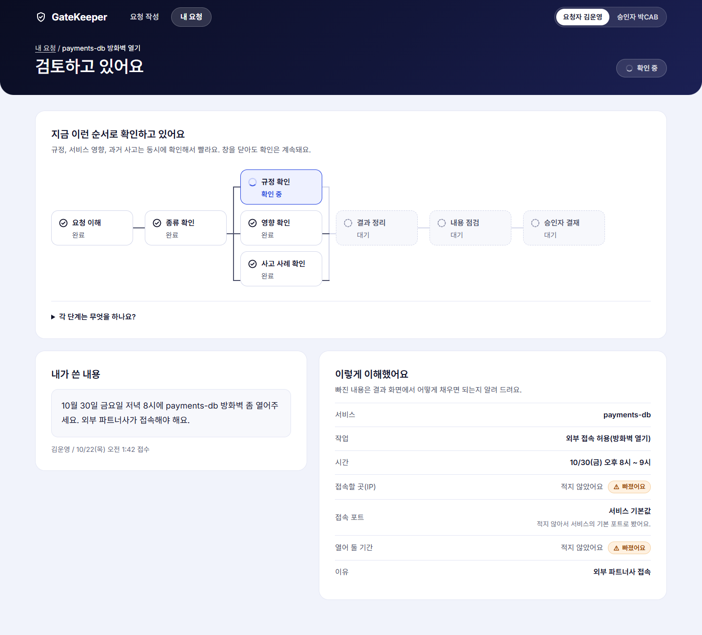 | 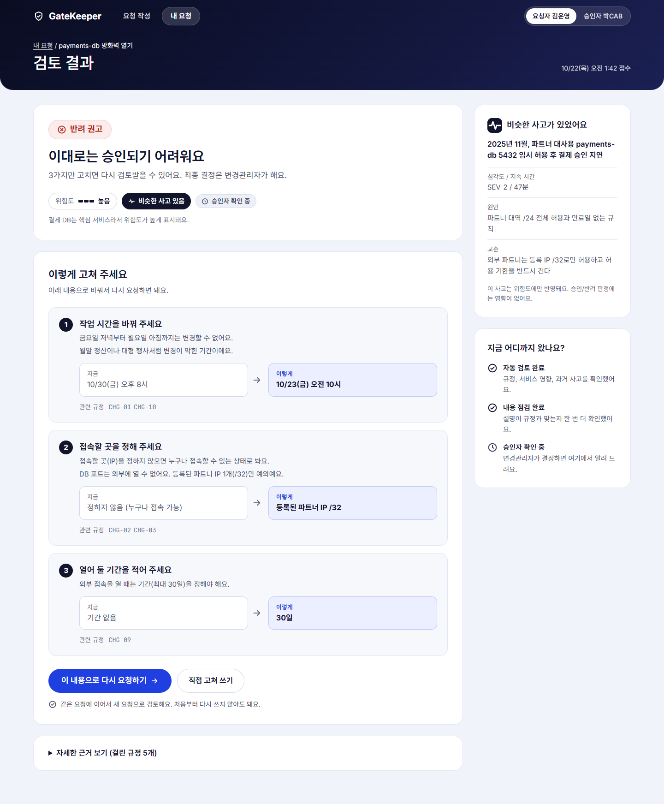 | 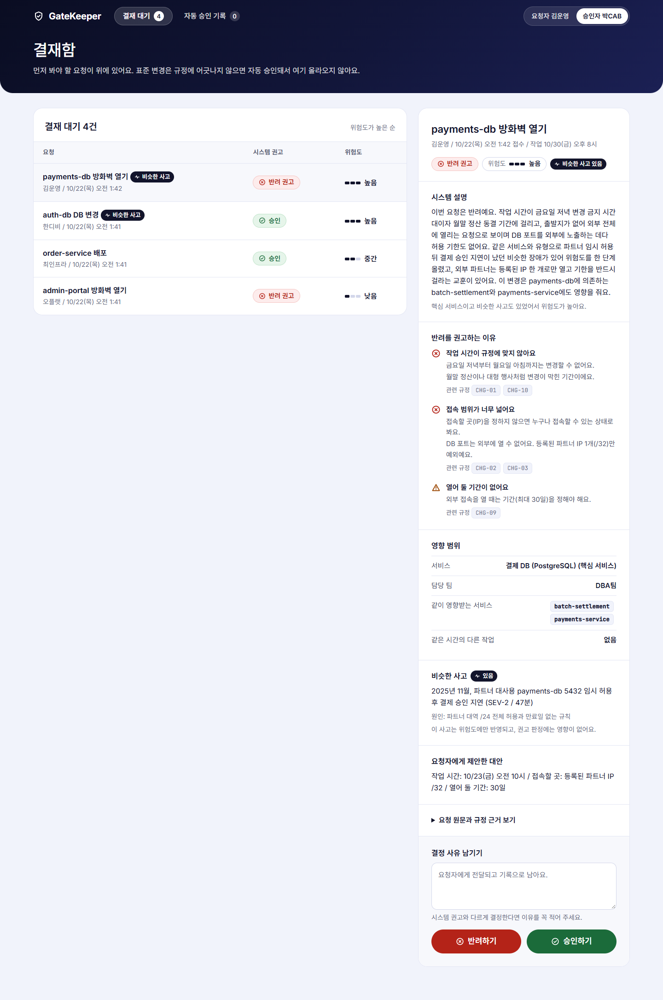 | 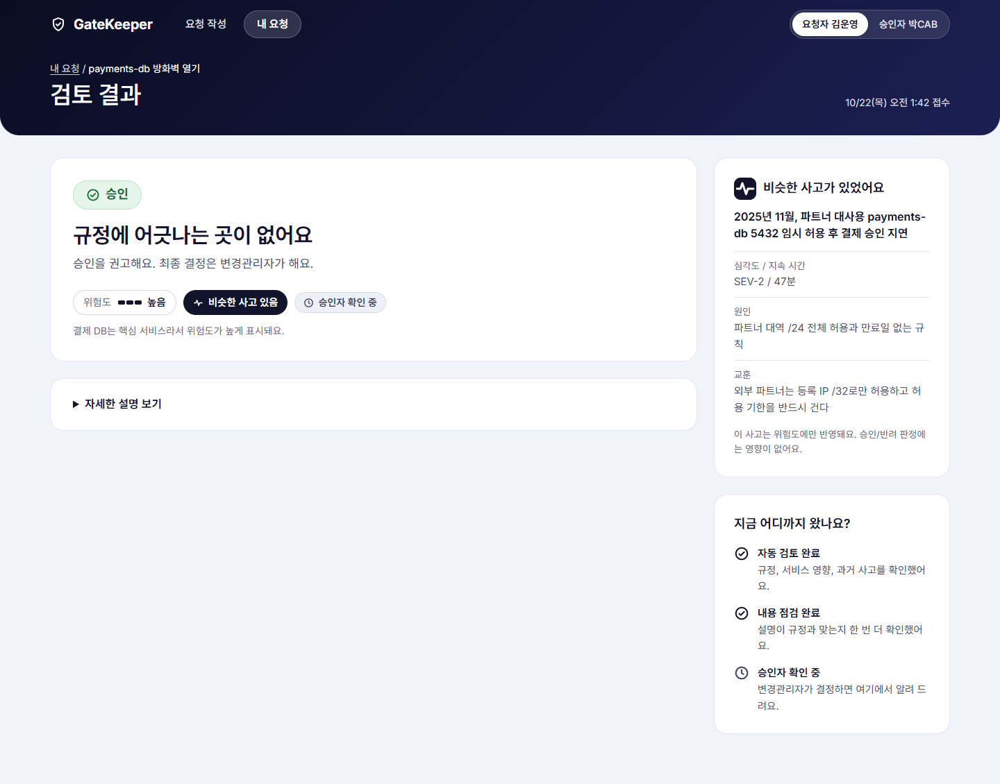 |

---

## 5. 구현 결과와 측정

### 5.1 버전 정의

| 버전 | 구성 | 확인하려는 것 |
|---|---|---|
| v0 | LLM 단독. 같은 정보(규정, CMDB, 캘린더, 장애 티켓)를 프롬프트로 제공 | 기준선 |
| v1 | + 결정론 MCP Tool, 라우팅, 병렬 서브에이전트, 코드 판정 | 판정 정확도, 모순, 일관성 |
| v2 | + 이력 하이브리드 RAG, Validator | 위험도, 근거 품질. 대신 지연과 토큰 |

모두 같은 코드베이스의 플래그(`GK_VERSION`)이고, 측정 대상은 사람 승인 직전의 권고다.

### 5.2 측정 축

- **Claude Sonnet 5.5**: 최종 평가의 기본 축. 대안 품질 Judge는 Opus 5.5.
- **로컬 소형 모델 qwen3:4b**: 사내 규정과 CMDB를 외부 API로 보낼 수 없는 회사를 가정한 축. Sonnet에서 v0도 dev 100%라 정확도가 갈리지 않는 것을 확인한 뒤 더한 **사후 축**이다(EVAL.md에 명시).

### 5.3 dev 결과 (10건 x 1회)

로컬 소형 모델 qwen3:4b (Judge 없음, num_ctx 10240)

| 지표 | v0 | v1 | v2 |
|---|---|---|---|
| 판정 정확도 | 40.0% | 80.0% | 80.0% |
| 위반 P / R / F1 | 0 / 0 / 0% | 76.9 / 83.3 / 80.0% | 76.9 / 83.3 / 80.0% |
| 구조화 정확도 | 81.2% | 83.5% | 85.0% |
| 오인용 조항 수 | 5 | 3 | 3 |
| 판정과 위반 목록의 자기모순 | 30% (3/10) | 0% | 0% |
| 위험도 일치 (n=8) | 25.0% | 87.5% | 100.0% |
| RAG 재현율@3 | - | - | 100% |
| 지연 평균 / p95 (초) | 11.2 / 16.7 | 65.9 / 91.5 | 81.4 / 111.6 |
| LLM 호출 / 실행 | 1.0 | 5.1 | 7.1 |

Claude Sonnet 5.5

| 지표 | v0 | v1 | v2 |
|---|---|---|---|
| 판정 정확도 / 위반 F1 | 100% / 100% | 100% / 100% | 100% / 100% |
| 위험도 일치 (n=8) | 87.5% | 87.5% | **100%** |
| 지연 평균 / p95 (초) | 11.3 / 15.5 | 12.9 / 19.5 | 19.6 / 27.2 |
| 토큰 / 실행 | 16,474 | 19,588 | 27,760 |
| LLM 호출 / 실행 | 1.0 | 4.5 | 6.7 |

### 5.4 Before/After 측정

최종 평가: eval 20건. Sonnet은 3회 반복(60실행), qwen3:4b는 1회(20실행). 여섯 실행 모두 같은 커밋(f8abcf0, 변경 없음)에서 돌았고, 측정 뒤 코드를 고치지 않았다. 원자료는 `results/*_eval.summary.json`, 해석은 [RESULTS.md](RESULTS.md)에 있다. 수치는 summary에서 그대로 옮겼다. 반올림은 RESULTS.md와 같고(백분율과 지연은 소수 첫째 자리, 호출 수와 대안 품질은 둘째 자리), 표시만 줄였다: 100.0%는 100%로, 요청당 비용은 소수 셋째 자리로 쓴다(RESULTS.md는 다섯째 자리).

**로컬 소형 모델 축 (qwen3:4b, Judge 없음, num_ctx 10240)**

| 지표 | v0 | v1 | v2 |
|---|---|---|---|
| 판정 정확도 | 35.0% | 75.0% | 70.0% |
| 위반 P / R / F1 | 66.7 / 21.1 / 32.0% | 65.0 / 68.4 / 66.7% | 64.7 / 57.9 / 61.1% |
| 판정과 위반 목록의 자기모순 | 15.0% | 0% | 0% |
| 위험도 일치 (n=18) | 22.2% | 88.9% | 88.9% |
| 긴급 판정 정확도 | 50% | 100% | 100% |
| 구조화 정확도 | 88.6% | 83.7% | 74.1% |
| RAG 재현율@3 | - | - | 81.8% |
| 지연 평균 / p95 (초) | 10.3 / 15.6 | 62.3 / 81.0 | 101.5 / 100.9 |
| LLM 호출 / 실행 | 1.00 | 5.05 | 6.70 |
| 오류 실행 | 0 | 0 | 2 (시간 초과 1, 검토 불가 1) |

**Claude Sonnet 5.5 축 (3회 반복, Judge는 Opus 5.5)**

| 지표 | v0 | v1 | v2 |
|---|---|---|---|
| 판정 정확도 | 100% | 100% | 100% |
| 위반 P / R / F1 | 100 / 100 / 100% | 95.0 / 100 / 97.4% | 95.0 / 100 / 97.4% |
| 3회 반복 일관성 | 100% | 100% | 100% |
| 위험도 일치 (n=54) | 88.9% | 88.9% | 100% |
| RAG 재현율@3 | - | - | 100% |
| 대안 품질 (Judge 1~5) | 4.85 | 4.51 | 4.59 |
| 환각 조항 | 0 | 0 | 0 |
| 지연 평균 / p95 (초) | 10.4 / 16.7 | 14.2 / 20.4 | 18.6 / 25.8 |
| 토큰 / 실행 | 16,429 | 19,616 | 27,047 |
| LLM 호출 / 실행 | 1.00 | 4.55 | 6.72 |
| 요청당 비용 (USD) | 0.044 | 0.048 | 0.068 |

읽는 법
- **약한 모델에서 구조의 효과가 크다.** v0에서 v1로 판정 정확도가 +40%p, 위반 F1이 +34.7%p, 위험도가 +66.7%p 올랐고 자기모순은 0이 됐다. dev에서 본 방향이 eval에서도 같게 재현됐다.
- **v2는 약한 모델에서 v1보다 나아지지 않았다.** 구조화 정확도가 낮아졌고 오류 실행이 2건 생겼다. 단계가 늘수록 작은 모델이 실패할 지점도 늘어난다.
- **강한 모델에서는 정확도와 일관성이 모두 포화됐다.** 예상했던 "3회 반복 일관성" 차이도 나타나지 않았다. 구조가 더한 측정 가능한 이득은 이력 RAG의 위험도 일치(88.9% → 100%)다.
- **강한 모델에서 구조가 잃은 것도 있다.** 위반 정밀도 95.0%(오탐 3건)와 대안 품질(4.85 → 4.51/4.59)이 v0보다 낮다. 오탐 3건은 구조화의 허용 만료 시각(expires_at) 불일치 3건(57/60)과 크기가 같고 반복 횟수(3회)와도 같아, 구조화 오류가 위반을 하나 더 만들었을 가능성이 있다. 사례 단위 확인은 정답 열람이 필요해 하지 않았으므로 추정이다. 판정 정확도는 100%라 판정은 바뀌지 않았다.
- 대안 품질은 시스템과 다른 모델(Opus)이 채점했다. 비용은 공식 단가표 기준이며 Judge 비용은 포함하지 않았다.

| qwen3:4b 판정 정확도 | qwen3:4b 위반 F1 | qwen3:4b 지연 p95 |
|---|---|---|
| 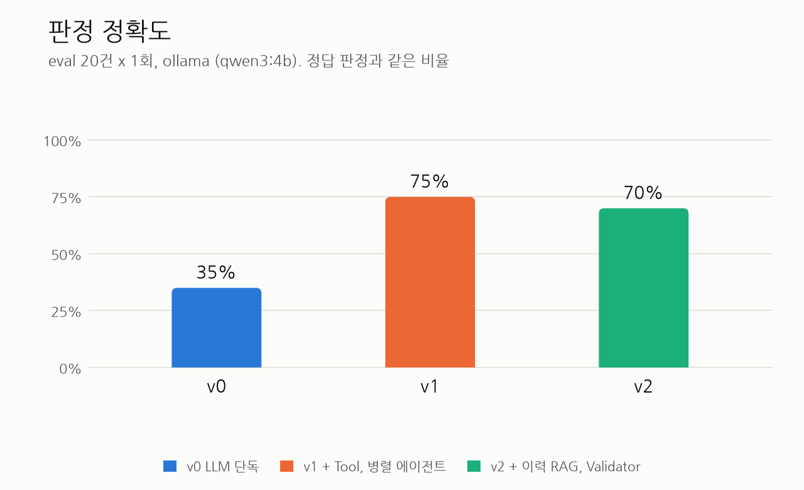 | 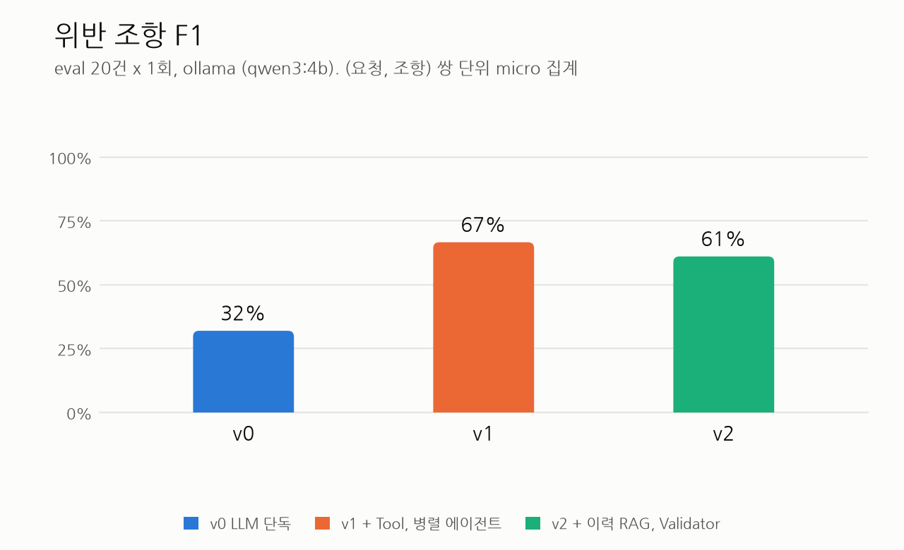 | 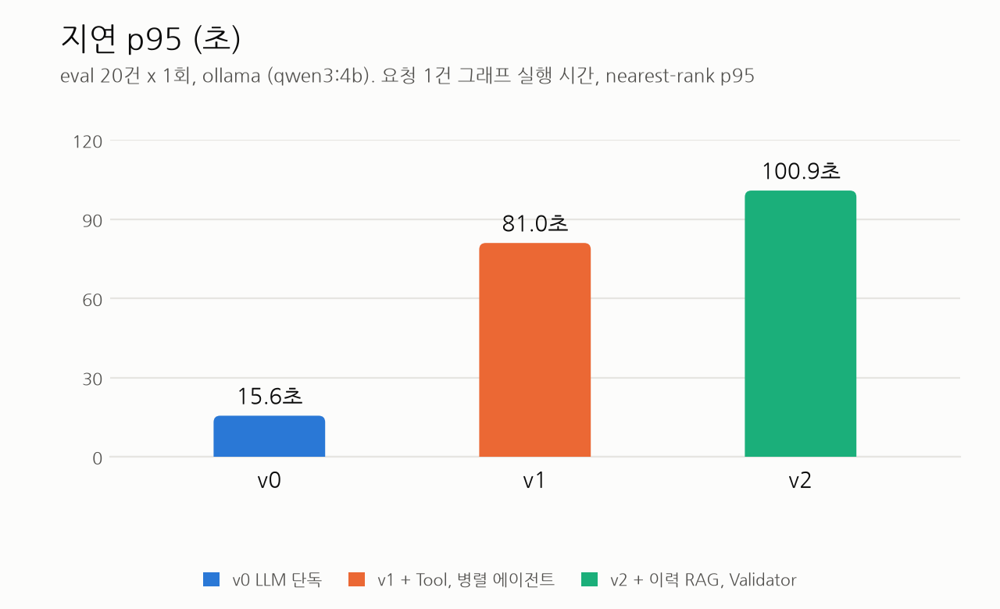 |

| Sonnet 판정 정확도 | Sonnet 토큰/실행 | Sonnet 지연 p95 |
|---|---|---|
| 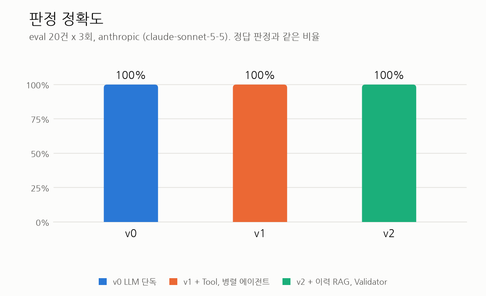 | 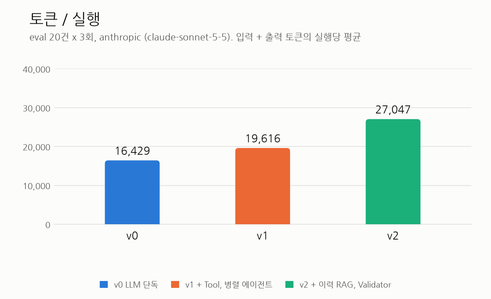 | 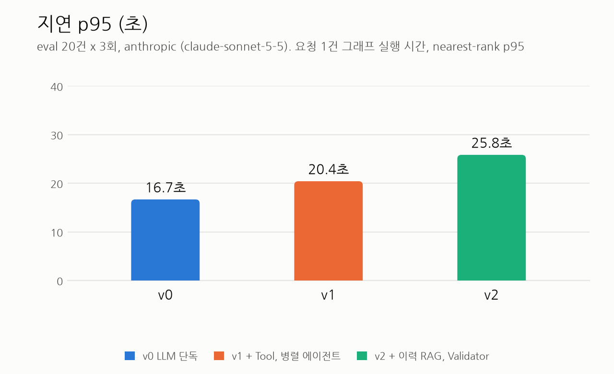 |

Sonnet v2의 Validator는 60실행에서 재작성 8회, 근거 검증 미완료 1건이었다(dev 2차의 재작성 2회와 비슷한 수준).

### 5.5 측정으로 찾고 고친 것

측정 결과를 숨기지 않고 1차, 원인, 수정, 2차로 남겼다.

| 발견 | 원인 | 수정 | 효과 |
|---|---|---|---|
| v1 첫 측정이 v0보다 낮음 (qwen3:8b, 40% vs 50%) | 리뷰가 짚은 원인: parse 프롬프트에 유형별 필수 항목과 표준 변경 조건이 없고, 표준 변경의 "다른 변경 없음"(빈 목록)을 null로 받음. 오류 2건의 직접 원인은 확정하지 못함 | 규정의 유형별 필수 항목과 표준 변경 목록을 파일에서 읽어 주입, v1 전용 규칙 추가 | Claude로 바꾼 뒤 변경 유형 구조화 10/10(1차 4/10). 모델이 바뀌어 수정의 몫은 분리하지 못함 |
| Claude에서 표준 변경이 확정되지 않음 | 와이어 스키마가 빈 목록과 null을 같은 값으로 합침 | `extra_changes_known` 필수 필드로 구분 | REQ-D04 자동 승인 |
| v1 대안 품질이 v0보다 낮음 (4.17 vs 4.83) | 조건 문장이 일반적("구체적인 IP를 적어 주세요") | 파트너 /32, 최대 기한, 만료일(코드 계산)을 조건 입력으로 제공 | 4.83 (v0와 같음) |
| Validator 오탐 7/10 | 검증 LLM이 decide가 본 근거 자료를 받지 못해 정당한 근거를 "근거 없음"으로 판단 | 근거 자료를 검증 입력에 포함 | 재작성 8 → 2회, 미완료 7 → 0건, 지연 평균 39.2 → 19.6초 |
| MCP Tool이 대상 오타를 내부 오류로 응답 | 엔진의 ValueError가 가려진 오류로 변환 | 엔진 호출 전 대상 확인, `NOT_FOUND`/`INVALID_ARGUMENT`로 구분 | 클라이언트가 "대상 없음"과 "서버 장애"를 구분 |

---

## 6. 교훈

### 6.1 한계와 트레이드오프

- **강한 모델에서는 정확도와 일관성이 포화된다.** Sonnet에서는 v0도 eval 100%, 3회 반복 일관성도 세 버전 모두 100%였다. 미리 기대했던 일관성 차이는 나타나지 않았다. 강한 모델에서 구조의 가치는 감사 가능성(조항별 근거, trace, 감사 로그), 이력 기반 위험도, 모델을 바꿔도 판정 기준이 그대로라는 점에 있다. 로컬 모델 축은 Sonnet 포화를 본 뒤 더한 사후 축이라 그 개선폭을 구조 일반의 효과로 일반화하지 않는다.
- **구조가 잃은 것도 있다.** Sonnet에서 v1/v2의 대안 품질(4.51/4.59)이 v0(4.85)보다 낮고, 위반 정밀도가 95.0%(오탐 3건)로 v0보다 낮다. 원인은 eval에서 분석하지 않았다. dev에서는 v1의 조건 문장이 일반적이라 구체성이 부족하다는 Judge 근거가 있었다.
- **구조의 대가는 지연과 비용이다.** Sonnet에서 지연 평균 10.4초 → 18.6초(+79%), 요청당 비용 $0.044 → $0.068(+54%), qwen3:4b에서 10.3초 → 101.5초. LLM 호출이 1회에서 약 7회로 늘었다. 재검토 조건: 지연이 허용치를 넘으면 Validator를 반려/조건부 판정에만 적용하고, 정적 프롬프트에 캐시를 쓴다.
- **단계가 늘면 작은 모델이 실패할 곳도 는다.** qwen3:4b에서 v2는 v1보다 정확도가 낮았고(75.0% → 70.0%) 시간 초과와 검토 불가가 1건씩 생겼다.
- **입력 구조화가 틀리면 코드도 틀린 입력으로 판정한다.** qwen3:4b가 동결 기간에 걸린 표준 변경(REQ-D10)의 날짜를 잘못 읽어 엔진이 자동 승인을 냈다. 이 건은 작은 모델과 엔진의 분류가 엇갈려 분류 불일치 경고가 붙으므로, 자동 승인은 표준 경로에서만 한다는 장치(K3)에 따라 사람에게 가도록 되어 있다(제품 경로로 직접 돌려 확인하지는 않았다). 근본 해결은 구조화 단계의 이중 확인이다.
- **평가 규모가 작다.** dev 10건, eval 20건이라 수치 차이를 통계적 결론으로 읽지 않는다. p95는 표본이 적어 최댓값에 가깝다.
- **Claude는 temperature를 고정할 수 없다.** 5.5 모델은 기본값 외 temperature를 받지 않아 같은 요청도 실행마다 달라질 수 있다. 그래서 3회 반복 일관성을 따로 쟀다(이번 eval에서는 흔들림이 없었다).
- **측정 지점은 사람 승인 직전이다.** "자동 승인은 표준 경로에서만" 같은 승인 단계의 안전장치는 이 수치에 들어 있지 않다. 작은 모델의 잘못된 자동 승인 중 일부는 실제 제품 경로에서는 승인자에게 간다.
- **규모 가정**: 이력 100건이라 평면 색인을 썼고, API 요청 목록은 메모리와 체크포인터로 관리한다. 대량 운영에는 ANN 저장소와 요약 테이블이 필요하다.
- **화면 문구의 숫자(30일, 24시간)는 화면에 고정돼 있다.** 규정이 바뀌면 화면 문구도 고쳐야 한다.

### 6.2 향후 개선

1. 구조화 이중 확인: 자동 승인 전에 원문의 날짜 표현과 구조화 시각을 대조하고, 어긋나면 사람에게 보낸다.
2. ITSM과 그룹웨어 결재의 웹훅으로 요청을 받는다(현재는 자체 화면).
3. 관리자 화면: 판정 분포, 반려 사유 순위, 처리 시간(구매자 페르소나의 성공 기준).
4. 고객사별 규정 Resource와 CMDB MCP 서버를 바꿔 끼우는 멀티 테넌트 구성.
5. 정답셋 확대와 경계 사례 보강, 정적 프롬프트 캐시로 지연 단축.
6. 재요청 화면에서 접속할 곳을 등록 파트너 목록(CMDB)에서 고르게 하기. 지금은 "이 내용으로 다시 요청하기"가 접속할 곳을 "등록된 파트너 IP"라는 문구로만 보내 한 번 더 반려된다(리허설에서 확인). 직접 고쳐 쓰면 통과한다.

**코드 점검 후보** (10단계 리뷰 결과. 측정이 끝난 코드라 고치지 않고 목록으로만 남긴다)

사용하지 않는 코드. Python은 vulture(신뢰도 60% 이상) 목록에서 프레임워크가 호출하는 함수와 pydantic 필드를 거르고 사용처를 저장소 전체에서 확인했다. 사용하지 않는 import는 없었다. 화면(`web/`)은 타입 검사(`vue-tsc`)만 통과를 확인했고 미사용 코드 도구는 돌리지 않았다.

- `app/api/store.py`의 `TERMINAL_STATUSES`와 `eval/rescore.py`의 `METRIC_KEYS`: 정의만 있고 어디서도 참조하지 않는다.
- `MCPClient.get_incident`, `read_standard`, `list_rule_uris`와 `total_retries`: 테스트에서만 쓴다. MCP 서버의 `get_incident` Tool은 등록돼 있지만 어떤 에이전트도 호출하지 않는다(긴급 티켓 검증은 `check_policy`가 한다).
- `app/llm/factory.py`의 `check_structured_output`: 구조화 출력 점검용 진단 도우미로, 테스트(live 포함)에서만 쓴다.

하드코딩된 규정 값. 시간 구간, 포트, 기한, 출발지 대역 같은 값은 `rules.json` params에서 읽는 것을 확인했다. 아래는 그 밖의 중복이다.

- `app/schemas.py`의 `KST = ZoneInfo("Asia/Seoul")`: 입력 시각 정규화용 상수로, rules.json `defaults.timezone`과 값이 겹친다(엔진은 rules.json을 읽는다).
- `app/schemas.py`의 서비스 등급 `Literal["Tier-1", "Tier-2", "Tier-3"]`: rules.json `risk.tier_to_risk`의 키와 겹친다.
- `app/agent/prompts/baseline_v0.md`의 등급별 위험도 문장: v0이 규정 본문을 프롬프트로 받는 설계의 일부지만 rules.json과 겹친다.
- `web/src/copy/rules.ts`와 `web/src/views/ApprovalsView.vue`의 30일, 24시간 문구: 화면에 고정된 값이다(6.1에 적음).
- `app/rules_engine/window.py`의 탐색 간격 30분과 범위 14일: 규정 값이 아니라 탐색 설정이라고 2단계에서 정했다.

테스트 누락. pytest 976건, 전체 줄 커버리지 98%(`app`, `eval`, `scripts`)다. 미커버 줄이 있는 파일 중 의미 있는 것은 다음이다.

- `app/api/main.py` 75%: 시작 때 RAG 준비를 확인하는 `ensure_rag_ready`(Ollama가 필요한 경로)와 재시작 뒤 닫은 요청의 경고.
- `eval/run_eval.py` 75%: 설정 오류(종료 코드 2)와 모든 실행이 오류일 때(종료 코드 1) 분기.
- `app/rules_engine/standard.py`: 표준 변경 목록에 없는 후보를 만났을 때의 분기.
- `app/agent/mcp_client.py` 95%의 재연결/시간 초과 일부 줄, `app/llm/fake.py` 87%, `eval/tracing.py` 88%.
- 자동 테스트가 없는 것: `sh/` 스크립트(`run_final_eval.sh` 포함), 실제 서버와 화면을 잇는 E2E(7단계에서 수동으로 확인). 실제 LLM을 부르는 테스트 21건은 기본 실행에서 제외된다.

### 6.3 수행 소감

"판정은 코드, 해석은 LLM"이라는 원칙을 처음에 정해 둔 것이 끝까지 설계의 기준이 됐다. 최종 평가에서 강한 모델은 LLM 단독으로도 정답을 다 맞혔고, 구조가 정확도를 두 배로 올린 것은 작은 로컬 모델에서였다. 구조를 더한다고 항상 좋아지는 것이 아니라 어떤 조건에서 무엇을 얻고 무엇(지연, 비용, 문장 품질)을 내주는지를 숫자로 보여야 한다는 것을 배웠다. 기대와 다른 결과를 숨기지 않고 1차, 원인, 수정, 2차로 남긴 기록이 이 프로젝트에서 가장 값진 결과물이라고 생각한다.
