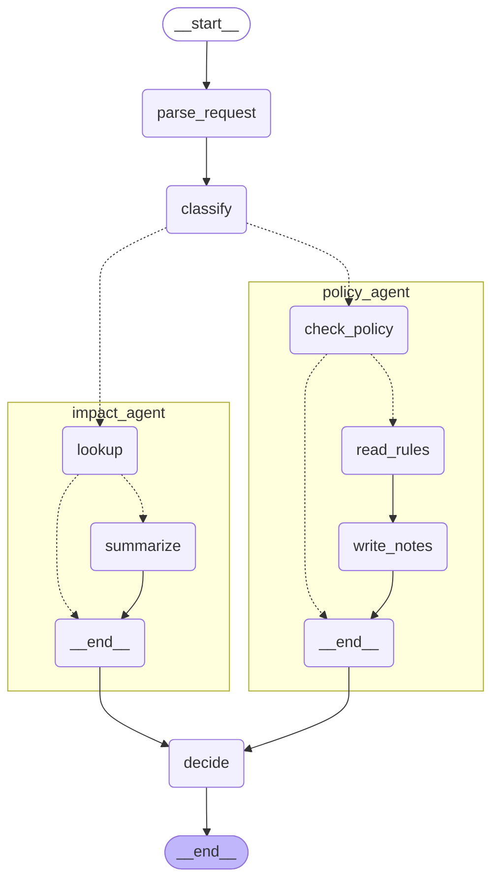

# 5단계 보고: v1 (구조화, 라우팅, 병렬 서브에이전트, 판정)

v1은 v0(LLM 단독)과 같은 입력으로 같은 `Recommendation`을 내되, 판정과 위반 조항은 결정론 규칙 엔진이 계산하고 LLM은 구조화, 해석, 설명, 대안 문장만 맡는다. 이 문서는 5단계 마무리(리뷰 N1~N3, K5 반영, anthropic으로 옮긴 dev 평가, v0/v1 비교)와 그 뒤에 한 두 가지, 곧 v1 대안 구체화(1차 → 수정 → 2차 측정)와 main 모델 축(Haiku)을 중심으로 쓴다.

## 이번 마무리에서 확인한 것

| 항목 | 결과 |
|---|---|
| 미커밋 변경 15개 파일 | 목적별로 N1 / N2+N3 / K5 / 문서로 나눠 커밋 (아래 커밋 분할 목록) |
| 리뷰 N1, N2, N3, K5 | 코드와 테스트 반영 + dev 측정으로 확인 (아래 표) |
| 측정 전 수정 | anthropic 와이어가 `extra_changes`의 빈 목록을 null로 바꾸던 문제 (사용자 결정, 아래) |
| v0 dev, v1 dev (anthropic) 각 1회 | 둘 다 오류 0/10, 판정 정확도 100% |
| v1 대안 구체화, 2차 측정 (Sonnet) | 대안 품질 4.17 → **4.83** (v0와 같음). 만료 날짜는 코드가 채움 (아래 "2차") |
| main 모델 축 (Haiku), v0와 v1 | 판정 정확도는 Haiku에서도 둘 다 100%. v1의 대안 품질은 4.00으로 Haiku v0(4.67)보다 낮고, 구체값 지시가 약한 모델에서 근거 없는 예시를 만든 사례가 있다 (아래 "모델 축") |
| report 모델 축, EVAL.md 1장과 6장 | 같은 provider 안에서 main 모델별 절로 나눔. 모델 축은 Sonnet이 동률인 것을 본 뒤에 더한 사후 축이라고 문서에 밝힘 |
| 환경 결정 | dev 평가를 anthropic으로 변경, 테스트 중 LangSmith 끄기, 줄바꿈 LF 통일 |

## 테스트 결과

- `pytest -q` → **692 통과**, 1 skip, 18 deselect(`-m llm` 전용). 이번 마무리 전 671 → 테스트 중 LangSmith 끄기 +3(674) → 와이어 수정 +4(678) → decide 조건 구체화 +11(689) → 리포트 모델 축 +3(692).
- decide 조건 구체화 뒤에는 `DecideDraft`의 conditions 설명을 바꿨는데, 이 스키마를 Anthropic이 받아들인 것은 v1 2차 측정(Sonnet, Haiku 모두 오류 0/10)으로 확인했다. 별도 live 스키마 테스트는 다시 돌리지 않았다.
- `pytest -q -m llm -k anthropic이_직접_보내는_스키마를_받아들인다` → **7 통과**. 와이어에 필수 bool을 더해도 선택 필드 0개, union 10/12(`V0Wire`)가 그대로라 Anthropic 네이티브 구조화 출력이 `WireChangeRequest`와 `V0Wire`를 그대로 받아들인다.
- 와이어 수정의 새 테스트 5건은 수정 전 코드(HEAD)에서 실패하고 수정 후 통과하는 것을 임시 worktree로 확인했다.
- 커밋 시점별 테스트는 N1 커밋(`3cd98ec`)에서만 따로 돌렸다(669 통과). 나머지 커밋은 최종 상태만 확인했다.
- 가운뎃점 없음. `.env`와 jsonl은 git 추적 대상이 아니다.

## v1 구조도

`build_graph("v1").get_graph(xray=True).draw_mermaid()`의 출력이다(컴파일만, LLM과 MCP는 호출하지 않음). `\3a`는 서브그래프 노드 id의 `:` 이스케이프다. 점선은 조건부 간선이다. classify 뒤에서 policy_agent와 impact_agent가 병렬로 갈라지고 decide에서 합쳐진다. 6단계 history_agent도 같은 모양으로 붙는다.

## dev 평가

### 1차 측정 조건 (Sonnet)

- 코드: `f239b5d`(와이어 수정 커밋). v0는 프롬프트를 수정하지 않은 기준선이다.
- `python eval/run_eval.py --version v0|v1 --split dev --reps 1 --provider anthropic --langsmith`. main `claude-sonnet-5-5`, small(분류) `claude-haiku-5-5`, Judge `claude-opus-5-5`(시스템 모델과 달라 독립).
- v0 `results/20261021-195001_v0_dev.summary.json`(약 2분 56초), v1 `results/20261021-195301_v1_dev.summary.json`(약 3분 12초). LangSmith 프로젝트 `gk-v0-dev-20261021-195001`, `gk-v1-dev-20261021-195301`. 리포트는 `results/report_anthropic.md`.
- v1 summary의 `git.dirty`는 true다. v0 summary 파일이 아직 커밋 전(untracked)인 채로 v1이 시작됐기 때문이고 코드는 같은 커밋이다.

### 1차: v0 대 v1 (anthropic Sonnet, 10건 x 1회)

| 지표 | v0 | v1 |
|---|---|---|
| 판정 정확도 | 100% (10/10) | 100% (10/10) |
| 위반 정밀도 / 재현율 / F1 | 100% / 100% / 100% (TP 12) | 100% / 100% / 100% (TP 12) |
| 구조화 정확도 | 100% | 100% |
| 환각 / 오인용 / 오인용(엄격) | 0 / 0 / 3 | 0 / 0 / 3 |
| 위험도 일치 | 87.5% (n=8) | 87.5% (n=8) |
| 긴급 판정 | 100% (n=1) | 100% (n=1) |
| 판정-위반 자기모순 | 0% (0/10) | 0% (0/10) |
| 대안 품질 (Judge 1~5) | **4.83** (n=6) | 4.17 (n=6) |
| 지연 평균 / p95 | **11.3초 / 15.5초** | 13.4초 / 20.6초 |
| 토큰 / 실행 (입력 + 출력) | **15,029 + 1,445 = 16,474** | 17,331 + 1,318 = 18,649 |
| reasoning 토큰 합계 (출력에 포함) | 6,348 | 4,122 |
| LLM 호출 / 실행 | **1.0** | 4.5 (sonnet 3.5 + haiku 1.0) |
| 오류 실행 | 0/10 | 0/10 |
| 재시도 카운터 | parse 0 | parse 0, 필수 항목 0, 분류 불일치 0, decide 0, 대안 재생성 0, 대안 대체 0 |

굵게 표시한 쪽이 더 나은 값이다. v1이 앞서는 지표는 이번 측정에 없다. v1 대비 v0는 지연 평균 -16%, p95 -25%, 토큰 -12%, 호출 수 1/4.5이다(v1 기준으로는 지연 평균 +19%, p95 +33%, 토큰 +13%).

비용(USD)은 `eval/pricing.json`이 비어 있어 "-"다.

### ollama 기록 (Mac, 참고만)

| 단계 | 버전 | 판정 정확도 | 위반 F1 | 비고 |
|---|---|---|---|---|
| 4 | v0 (qwen3:8b) | 50.0% | 20.0% | 판정-위반 자기모순 6/10(60%, 재채점) |
| 5 1차 | v1 (qwen3:8b, 분류 qwen3:0.6b) | 40.0% | 26.7% | N1~N3, K5 반영 전, 오류 2건(REQ-D01, D07) |

이 두 줄은 지우지 않았다. 모델이 달라 위 anthropic 표와 직접 비교하지 않는다. ollama 2차 측정은 하지 않았다(이 PC에서 느림).

### 해석

**정확도로는 v0와 v1이 갈리지 않았다.** v0 판정 정확도가 90%를 넘으므로 EVAL.md 6장의 경우다. 정답셋은 바꾸지 않고, 정확도 대신 일관성, 환각 조항 수, 비용에서 차이를 봐야 한다. 이번 dev는 reps=1이라 일관성이 "-"이고 환각은 둘 다 0이라, 9단계의 eval 20건 x 3회에서 확인할 몫이다. Claude Sonnet 5.5에서는 규정 원문과 데이터를 모두 받은 v0 단독도 dev 10건을 전부 맞혔다(같은 dev에서 qwen3:8b는 50%였다). v1의 구조적 보장(판정을 코드가 계산하므로 자기모순이 구조적으로 0)은 모델 출력에 기대지 않지만, 이번에는 v0도 모순을 내지 않아서 수치로는 드러나지 않았다.

**v1이 v0보다 못한 지표가 있다.** 대안 품질 4.83 대 4.17(n=6, 단일 실행이라 노이즈일 수 있다), 지연, 토큰이다. 대안 품질은 Judge 근거에서 이유가 읽힌다. v1의 대안은 일정은 엔진이 검증한 구체적 시각인데 조건 문장이 일반적이다: REQ-D05 3점(Judge: "만료일 같은 값 없이 일반론에 그쳐 구체성이 크게 부족하다"), REQ-D03 4점("이 변경에 맞는 구체적 롤백 예시가 없어 다소 일반적이다"), REQ-D09 4점("'30일 이내'로만 안내해 값이 다소 모호합니다"), REQ-D01 4점(어느 파트너 IP인지와 기한 날짜를 특정하지 않음). v0는 IP 형식, 기한 날짜, 롤백 명령까지 예시로 쓴다. 또 여러 요청에서 "반영해 다시 제출한다.", "이 조건을 충족하면 조건부로 승인할 수 있다."가 똑같이 붙고 "제출해 주세요"와 "~한다"가 섞인다. 반복되는 문구라 코드가 조립하는 부분으로 보이지만 코드는 확인하지 않았다. 7단계 화면이 이 문장을 승인자에게 그대로 보여 주는지도 확인이 필요하다.

**이 약점은 이후 고쳤다.** decide의 conditions를 구체값으로 쓰게 했고(아래 "2차"), 이 표를 1차로 남겼다. v1 프롬프트는 dev로 고쳐도 된다(EVAL 2장). 고치지 않은 것: 대안 문장 끝의 고정 문구("반영해 다시 제출한다.", "이 조건을 충족하면 조건부로 승인할 수 있다.")와 말투 혼재는 그대로다.

### N1~N3, K5 확인 결과

| 항목 | 결과 |
|---|---|
| N1 ReviewIncomplete 원인 | 사유 기록과 작업 구간 재시도는 테스트로 고정했다. 이번 측정은 오류 0/10, 재시도 카운터 0이라 **N1 경로는 실제로 발동하지 않았다.** 1차(ollama)의 REQ-D01/D07 원인(종료 ≤ 시작)은 추정이고, 1차 jsonl이 없고 이번 모델에서 재현되지 않아 **확정하지 못했다.** |
| N2 변경 유형 | 변경 유형 구조화 10/10(1차 ollama는 40%). 모델이 바뀌었으므로 프롬프트 주입의 기여는 분리할 수 없다. |
| N3 extra_changes | REQ-D04의 구조화가 `extra_changes=[]`이고 엔진이 STD-01을 확정해 "자동 승인"이 나왔다. anthropic에서는 아래 와이어 수정이 있어야 통과하는 항목이다. |
| K5 설명 문체 | 10건 모두 해요체이고 규정 번호와 영어 약어는 0건. 다만 REQ-D01, D08은 4문장이라 "두세 문장"을 넘었다. |

### 2차: v1 대안 구체화 (Sonnet, 코드 `9915159`)

1차의 약점(조건 문장이 일반적)을 사용자 요청으로 고치고 v1을 다시 쟀다. 1차 summary는 지우지 않았다.

- `decide.md`의 conditions: 출발지는 등록 파트너 IP/32 예시, 허용 기한은 최대 일수와 만료 날짜, 롤백은 되돌리는 방법 예시, 테스트 증적은 실행 일시/통과 여부/확인 항목 예시로 쓰게 한다. 일반론으로 끝내지 않게 하고 코드가 붙이는 문장과 말투를 평서문으로 맞춘다.
- 값은 코드가 데이터에서 읽어 입력의 "조건에 쓸 값"으로 준다: CMDB `partners`(방화벽만), `rules.json` CHG-09 `max_days`, 변경 사유. 프롬프트에는 데이터 값을 쓰지 않는다(테스트로 고정).
- 만료 날짜는 모델이 `<만료일>`만 쓰고, 검증을 통과한 최종 작업일(엔진 대체 포함, 일정을 안 옮기면 요청 작업일)에 `max_days`를 더해 코드가 채운다. 모델이 날짜 덧셈을 틀리고 대안 일정이 바뀔 수 있어서다. 작업일을 모르면 날짜를 지어내지 않고 "작업일로부터 N일째 되는 날"로 쓴다.
- 대안 시각은 그대로 코드가 검증해 문장 맨 앞에 붙인다. 조건에 날짜를 쓸 때는 그 시각의 날짜와 맞게 하라는 지시만 더했다.

| 지표 (Sonnet v1) | 1차 | 2차 |
|---|---|---|
| 판정 정확도 / 위반 F1 / 구조화 | 100% / 100% / 100% | 100% / 100% / 100% |
| 대안 품질 (n=6) | 4.17 | **4.83** (v0와 같음) |
| 요청별 대안 점수 (D01, D03, D05, D08, D09, D10) | 4, 4, 3, 5, 4, 5 | 5, 5, 4, 5, 5, 5 |
| 지연 평균 / p95 | 13.4초 / 20.6초 | 12.9초 / 19.5초 |
| 토큰 / 실행 | 17,331 + 1,318 = 18,649 | 18,214 + 1,374 = 19,588 |
| LLM 호출 / 실행, 오류 | 4.5, 0/10 | 4.5, 0/10 |

만료 날짜가 코드로 채워진 것을 확인했다: D01은 대안 작업일 11/2(월) 기준 12/2(수), D05는 10/29 기준 11/28, D09는 10/27 기준 11/26(목)이고 날것 `<만료일>`은 0건이다. 점수가 오른 4건(D01, D03, D05, D09)의 Judge 근거는 롤백 예시(`DROP COLUMN`과 확인 방법), 파트너 IP/32와 만료일, 구체적인 만료 날짜를 짚는다. D05는 아직 4점이다(출발지가 `x.x.x.x` 자리표시로 남고 재택 팀원이 여럿인데 한 개만 허용하라고 해 따라 하기 모호하다는 지적). 입력 토큰이 늘었는데(+883/실행) 프롬프트와 입력이 길어진 영향으로 보이며 분해해 확인하지는 않았다. n=6, 단일 실행이라 차이가 노이즈일 수 있다.

### 모델 축: main 모델을 Haiku로 바꿔 다시 잰 결과 (사후에 더한 축)

사용자 요청으로 `MODEL_MAIN=claude-haiku-5-5`만 바꿔 v0와 v1(2차 코드)을 같은 조건으로 1회씩 쟀다(main과 small이 모두 Haiku, Judge는 `claude-opus-5-5`). 이 축은 Sonnet dev에서 v0와 v1이 모두 100%로 갈리지 않는 것을 본 뒤에 더한 것이다. 정답셋과 v0 프롬프트는 바꾸지 않았고, 결과가 어느 쪽이든 적는다고 EVAL.md 6장에 먼저 적었다. 아래 표는 summary에서 직접 뽑았다.

| 지표 | Sonnet v0 | Sonnet v1 1차 | Sonnet v1 2차 | Haiku v0 | Haiku v1 |
|---|---|---|---|---|---|
| git 커밋 (dirty) | f239b5d | f239b5d (dirty) | 9915159 | ad0b075 | be0ad3e |
| 판정 정확도 | 100.0% | 100.0% | 100.0% | 100.0% | 100.0% |
| 위반 P / R / F1 | 100% / 100% / 100% | 100% / 100% / 100% | 100% / 100% / 100% | 100% / 100% / 100% | 100% / 100% / 100% |
| 구조화 정확도 | 100.0% | 100.0% | 100.0% | 99.2% | 100.0% |
| 환각 / 오인용 / 엄격 | 0 / 0 / 3 | 0 / 0 / 3 | 0 / 0 / 3 | 0 / 0 / 3 | 0 / 0 / 3 |
| 위험도 일치 (n=8) | 87.5% | 87.5% | 87.5% | 87.5% | 87.5% |
| 판정-위반 자기모순 | 0.0% (0/10) | 0.0% (0/10) | 0.0% (0/10) | 0.0% (0/10) | 0.0% (0/10) |
| 대안 품질 (n=6) | 4.83 | 4.17 | 4.83 | 4.67 | 4.00 |
| 지연 평균 / p95 (초) | 11.3 / 15.5 | 13.4 / 20.6 | 12.9 / 19.5 | 13.1 / 22.6 | 12.6 / 20.1 |
| 토큰/실행 입력 + 출력 | 15,029 + 1,445 = 16,474 | 17,331 + 1,318 = 18,649 | 18,214 + 1,374 = 19,588 | 15,029 + 2,851 = 17,880 | 18,189 + 1,939 = 20,128 |
| reasoning 토큰 합계 (출력에 포함) | 6,348 | 4,122 | 4,121 | 19,781 | 9,664 |
| LLM 호출 / 실행 | 1.0 | 4.5 | 4.5 | 1.0 | 4.5 |
| 재시도 카운터 합 | 0 | 0 | 0 | 0 | 0 |
| 오류 실행 | 0/10 | 0/10 | 0/10 | 0/10 | 0/10 |

읽는 법:

- **다섯 조건 모두 판정 정확도 100%다.** 약한 모델(Haiku)에서도 v0가 dev 10건을 전부 맞혔다. 그래서 이번 dev에서는 모델 축으로도 v0와 v1이 정확도로 갈리지 않는다. dev 10건과 규정이 이 모델들에게는 쉬워서 변별력이 없다는 뜻이고, 9단계 eval 20건 x 3회에서 일관성으로 볼 몫이다(정답셋은 바꾸지 않는다).
- **비용 쪽은 두 모델에서 같은 방향이다.** v1은 LLM 호출이 4.5배이고 토큰이 Sonnet에서 +19%, Haiku에서 +13%(2차 코드 기준) 늘었다.
- **지연은 모델에 따라 다르다.** Sonnet에서는 v1이 더 느리다(평균 12.9초 대 11.3초, p95 19.5초 대 15.5초). Haiku에서는 v1이 오히려 짧다(평균 12.6초 대 13.1초, p95 20.1초 대 22.6초). Haiku v0가 한 번에 쓰는 reasoning 토큰이 19,781로 많고, v1은 일을 쪼개 9,664로 줄었다. n=10, 단일 실행이라 방향만 본다.
- **Haiku v0 구조화는 `source` 한 건이 틀렸다**(9/10, 99.2%). v1은 100%지만 한 건 차이라 구조의 효과로 읽지 않는다.
- **같은 모델 안에서 v1의 대안 품질은 v0 이하다.** Sonnet 4.83 대 4.83(2차), Haiku 4.00 대 4.67. 아래 약점 참고.

### 구체값 지시의 부작용: 약한 모델에서 근거 없는 예시

Haiku v1(대안 4.00)의 낮은 점수 두 건은 구체값을 쓰라는 지시가 약한 모델에서 맞지 않는 예시를 만든 사례다. 개선이 새로 만든 약점이라 숨기지 않고 적는다.

- **REQ-D08(3점)**: 입력의 `변경 사유`가 None("적혀 있지 않음")이었는데, "변경 사유를 보고 롤백 예시를 쓴다"는 지시를 받은 Haiku가 근거 없이 인덱스 추가와 `DROP INDEX` 예시를 만들었다. 실제 변경은 `max_connections`라 Judge가 "재시작 검증 증적을 제대로 제출할 수 없다"고 지적했다. 같은 입력에서 Sonnet은 5점이었다.
- **REQ-D05(2점)**: 사유가 "재택 운영팀 외부 접근 필요"인데 DB 연동용 외부 파트너 IP 세 개를 예시로 들었고, "11/28까지"와 "작업 종료 후 즉시 삭제"가 서로 모순이었다. 프롬프트가 등록되지 않은 출발지는 형식만 보이라고 했지만 따르지 않았다.
- 원인은 "입력에 근거가 없으면 예시를 만들지 말고 형식만 보인다"는 지시가 없었던 것으로 본다(확정은 아니다). 이번에는 고치지 않았다. 후보: 근거가 없으면 일반 형식만 쓰게 하는 한 줄, 변경 내용을 입력에 더 주기. 고치면 이 측정을 1차로 남긴다.
- D01(Haiku 4점)은 "실제 접속할 파트너를 확인하지 않고 B페이먼츠를 임의로 지정"했다는 지적이다.

## 측정 전 수정: 와이어가 extra_changes의 빈 목록과 null을 구분

N3를 anthropic에서 실제로 통하게 하려고 측정 전에 고쳤다(사용자 결정, `f239b5d`).

- 문제: `WireChangeRequest.to_domain`이 `extra_changes`의 빈 목록을 None으로 바꿨다(J2의 "빈 목록과 null 구분 손실은 감수" 결정). 규칙 엔진은 None이면 STD-01을 확정하지 않으므로(fail-safe) anthropic에서는 표준 변경이 항상 배포로 간다. 프롬프트로 N3 문장을 더해도 와이어에서 값이 사라져서 효과가 없다.
- 수정: 와이어에 필수 bool `extra_changes_known`을 더했다. true면 목록을 그대로(빈 목록 유지), false면 None으로 돌린다. nullable로 두지 않은 것은 union 필드가 늘어 복잡도 한도에 닿기 때문이다.
- v0와 v1이 같은 와이어를 쓰므로 둘 다 이 수정 뒤의 코드로 측정했다. 처음 띄운 v0 측정은 수정 전 코드였기 때문에 중단하고 부분 기록을 지운 뒤 다시 돌렸다.
- 검증: dev 정답 구조화 10건이 와이어를 왕복해도 `extra_changes`까지 같고, 와이어를 거친 REQ-D04를 엔진이 STD-01로 확정한다. live 스키마 수락 7건 통과.

## 핵심 코드 설명 (발표용)

1. **판정은 코드, LLM은 설명 (decide).** 위반 조항, 판정, 위험도, 인용은 엔진 결과로 계산하고 LLM은 설명, 조건 목록, 대안 일정 제안만 쓴다. 대안 일정은 `check_window`로 다시 검사하고 계속 위반이면 엔진이 찾은 가장 빠른 통과 시간대로 바꾼다. 말이 그럴듯해도 규정을 어긴 일정이 승인자에게 가지 않게 하려는 것이다.
2. **서브에이전트는 컴파일된 서브그래프, Tool 호출은 코드가 정한다 (policy_agent, impact_agent).** 위 구조도처럼 각자 자기 상태와 내부 노드를 갖고 병렬로 돈다. 판정 경로에 LLM의 도구 선택을 넣지 않는 것이 설계 주장이라, LLM은 Tool 결과를 읽고 쉬운 설명만 쓴다. `violations[].evidence`는 엔진 문장 그대로 둔다(K2).
3. **되묻되 값을 지어내지 않는다 (parse_request).** 필수 항목이 비었거나 엔진이 거절할 값(종료 ≤ 시작, CMDB에 없는 대상)이면 한 번만 다시 묻고, 그래도 틀리면 값을 고쳐 쓰지 않고 `ReviewIncomplete`로 멈춘다. 본문에 종료 시각이 있었는지 코드는 모르므로, 고쳐 쓰면 조용히 틀린 구간으로 판정하게 된다. 종료가 없을 때의 기본 작업 시간은 모델이 덧셈을 틀리므로 코드가 계산해서 알려 준다.
4. **규정 표를 파일에서 읽어 프롬프트에 넣는다 (N2).** 유형별 필수 항목(4장)과 표준 변경 목록(3장)을 `change_policy.md`에서 파싱한다. 규정이 바뀌면 원문만 고치면 되고, 표를 못 찾으면 빈 프롬프트가 나가지 않게 멈춘다.
5. **멈춘 이유는 dev에만 남긴다 (N1).** `ReviewIncomplete.stage/detail`에는 대상 값과 작업 구간이 들어갈 수 있어서 평가 하네스가 dev 기록과 터미널에만 남기고 eval 기록과 API 응답에는 예외 타입만 남긴다(절대 규칙 1).
6. **null과 빈 목록은 다른 뜻이다 (와이어).** "다른 설정이 없다"와 "알 수 없다"를 같은 값으로 합치면 엔진의 fail-safe가 무력해진다. 그래서 둘을 구분하는 필수 bool을 두었다.
7. **분류가 어긋나도 엔진 확정값은 유지한다 (classify, K3).** 작은 모델의 오류가 판정 정확도로 새지 않게 하고, 불일치는 경고로 남겨 사람이 확인하게 한다.
8. **값은 코드가 주고 날짜 계산도 코드가 한다 (decide의 조건 문장).** 구체적인 문장을 쓰게 하려고 파트너 IP, 허용 기한 최대 일수, 변경 사유를 데이터에서 읽어 입력에 준다. 프롬프트에 값을 쓰면 규정이나 CMDB가 바뀔 때 어긋난다. 만료 날짜는 모델이 `<만료일>`만 쓰고 코드가 최종 작업일에서 더해 채운다. 모델이 날짜 덧셈을 틀리고 대안 일정이 검증이나 대체로 바뀔 수 있어서, 문장 속 날짜가 최종 일정과 어긋나지 않게 하려는 것이다.

## 알아 둘 점

- dev는 n=10, reps=1이고 anthropic은 temperature를 보내지 않아 비결정론이다. 특히 대안 품질은 n=6이라 차이가 노이즈일 수 있다.
- 지연과 토큰에는 thinking이 섞여 있다(reasoning 토큰 합계는 v0 6,348, v1 4,122).
- v1 summary의 dirty 표시는 위 "측정 조건" 참고. 코드는 `f239b5d`다.
- 이 측정은 dev의 확인이지 최종 결과가 아니다. 9단계에서 eval 20건 x 3버전 x 3회로 일관성과 비용까지 본다.
- Mac의 ollama 측정 결과(summary, `report.md`, `charts/`, PROGRESS 행)는 그대로 두었고, anthropic 리포트는 파일명을 분리해 따로 만들었다. `report_anthropic.md`는 모델별 절이고 버전마다 최신 실행만 쓰므로 Sonnet v1 1차는 이 문서의 표에만 있다(summary 파일은 남아 있다).
- Haiku 축은 사후에 더한 축이다(EVAL.md 6장에 밝힘). 다섯 조건이 모두 100%라서, 이 dev로는 어느 모델에서도 v0와 v1을 정확도로 가르지 못했다. 이것을 v1의 가치가 없다는 결론으로 읽지 않는다. v1의 보장(판정을 코드가 계산, 인용을 코드가 생성)은 모델에 기대지 않지만, 쉬운 dev에서는 v0도 어기지 않았을 뿐이다.
- 대안 품질이 같은 모델 안에서 v0 이하인 점(Sonnet 동률, Haiku 4.00 대 4.67)은 v1의 열린 약점이다. 대안 문장 끝의 고정 문구와 말투 혼재도 그대로다.
- 위 5열 표는 summary JSON에서 스크립트로 뽑았다(손으로 옮기지 않음). 스크립트는 저장소에 넣지 않았다.

## 커밋 분할 목록

### 5단계 본 구현 (이전 세션)

| 해시 | 메시지 | 파일 |
|---|---|---|
| `b4e8eb5` | docs: 5단계 계획과 리뷰 피드백 (H1, J1, K1~K4 반영) | docs/handoff/feedback.md, docs/plans/stage5.md |
| `23a887a` | feat(eval): 판정과 위반 목록의 자기모순 지표 | docs/EVAL.md, eval/evaluators.py, eval/harness.py, eval/report.py, eval/rescore.py, tests |
| `634bb10` | chore(eval): v0 dev 측정을 자기모순 지표로 재채점 | results v0 summary, report.md, charts |
| `7a0e8ad` | test(llm): fake LLM에 구조화 출력 스키마별 응답 큐 | app/llm/fake.py, tests/test_llm_factory.py |
| `08946ea` | feat(agent): parse_request 노드 (필수 항목 재시도, anthropic 와이어) | app/agent/nodes/parse_request.py, wire.py, errors.py, prompting.py, prompts/parse_request.md, tests |
| `3f98965` | feat(agent): classify 노드 (작은 모델 1차 분류와 결정론 확정) | app/agent/nodes/classify.py, prompts/classify.md, state.py, tests |
| `b25b6c6` | feat(agent): policy_agent와 impact_agent 서브그래프 | app/agent/nodes/policy_agent.py, impact_agent.py, prompts, results.py, tests |
| `38bd013` | feat(agent): decide 노드 (엔진 판정, 대안 일정 검증, 시각 누락 경고) | app/agent/nodes/decide.py, prompts/decide.md, tests |
| `832ac1e` | feat(agent): v1 그래프 조립과 병렬 서브에이전트 | app/agent/graph.py, tests/test_graph_v1.py |
| `a8bece8` | feat(eval): v1 실행을 위한 MCP 클라이언트 수명 관리 | eval/harness.py, eval/report.py, tests |
| `eebe761` | test(llm): v1 live 테스트와 스키마 수락 확인 | tests/test_llm_live.py, tests/test_wire.py |
| `ed8c89f` | fix(eval): warm-up이 ReviewIncomplete를 측정할 행동으로 넘긴다 | eval/harness.py, tests/test_run_eval.py |
| `6ae500b`, `4eef2ba` | docs: SPEC을 5단계 구현에 맞춰 갱신, EVAL에 v1 재질문을 개선 내용으로 명시 | docs/SPEC.md, docs/EVAL.md |
| `2727dc8`, `f3ce052` | chore(eval): v1 dev 첫 측정 결과 (summary, 리포트와 차트) | results |
| `0e1fc5f` | docs: PROGRESS에 5단계 진행 중 상태를 기록 | docs/PROGRESS.md |

### 5단계 마무리 (이번 세션)

| 해시 | 메시지 | 파일 |
|---|---|---|
| `7c7ba99`, `ac96ae2`, `12b25b1` | Windows 대응: sh 줄바꿈 LF, venv python 탐색, tzdata 설치 | .gitattributes, sh/, requirements.txt |
| `7e04319` | chore(git): 줄바꿈을 모든 파일 LF로 통일 | .gitattributes |
| `29b0825` | test: 테스트 중 LangSmith 추적을 끈다 | tests/conftest.py, tests/test_tracing_off.py |
| `3cd98ec` | fix(agent): ReviewIncomplete 원인을 기록하고 틀린 작업 구간을 다시 묻는다 (N1) | app/agent/errors.py, nodes/decide.py, nodes/parse_request.py, eval/evaluators.py, eval/harness.py, tests 4개 |
| `ae0ffc6` | feat(agent): parse_request 프롬프트에 규정의 변경 유형 기준을 넣는다 (N2, N3) | app/agent/prompting.py, prompts/parse_request.md, nodes/parse_request.py, tests/test_parse_request.py |
| `d59059e` | feat(agent): decide 설명을 규정 번호 없는 쉬운 해요체로 쓰게 한다 (K5) | app/agent/prompts/decide.md, tests/test_decide.py |
| `e201237` | docs: v1 수정 내용을 SPEC과 EVAL에 반영 (N1~N3, K5) | docs/SPEC.md, docs/EVAL.md |
| `faa49ad` | docs: PROGRESS 8단계를 목업 기준 완료로 표시 | docs/PROGRESS.md |
| `6410972` | docs: dev 평가 provider를 anthropic으로 바꾼다 | CLAUDE.md, docs/EVAL.md, docs/SPEC.md |
| `f248db0` | docs: 5단계 진행 상황과 환경 결정을 PROGRESS에 기록 | docs/PROGRESS.md |
| `f239b5d` | fix(agent): 와이어가 extra_changes의 빈 목록과 null을 구분 | app/agent/wire.py, tests/test_wire.py, tests/test_parse_request.py |
| `f7b2eb4` | chore(eval): v0/v1 dev 측정 결과 (anthropic) | results summary 2개, report_anthropic.md, charts_anthropic/ |
| `2753201` | docs: 5단계 보고 | docs/reports/stage5.md |
| `b629e6f` | docs: PROGRESS에 5단계 완료와 anthropic 측정을 기록 | docs/PROGRESS.md |
| `9915159` | feat(agent): decide 조건 문장을 대안의 구체 값으로 쓰게 한다 | app/agent/nodes/decide.py, prompts/decide.md, tests/test_decide.py |
| `a4ab491` | feat(eval): 리포트가 같은 provider 안에서 main 모델별로 나눠 보인다 | eval/report.py, tests/test_report.py |
| `522a0d3` | docs: EVAL에 모델 축을 적는다 (1장, 6장) | docs/EVAL.md |
| `ad0b075` | chore(eval): v1 dev 2차 측정 결과 (anthropic sonnet, 조건 문장 구체화 후) | results summary 1개 |
| `be0ad3e` | chore(eval): v0 dev 측정 결과 (anthropic, MODEL_MAIN=claude-haiku-5-5) | results summary 1개 |
| `5e00196` | chore(eval): v1 dev 측정 결과 (anthropic, MODEL_MAIN=claude-haiku-5-5) | results summary 1개 |
| `ffb5774` | chore(eval): anthropic 리포트를 main 모델별 절로 다시 만든다 | results/report_anthropic.md, results/charts_anthropic/ (모델 없는 옛 차트 6장 삭제, 모델별 12장) |
| (이 문서의 커밋) | docs: 5단계 보고에 2차 측정과 모델 축을 반영 | docs/reports/stage5.md |
| (다음 커밋) | docs: PROGRESS에 2차 측정과 모델 축을 기록 | docs/PROGRESS.md |
