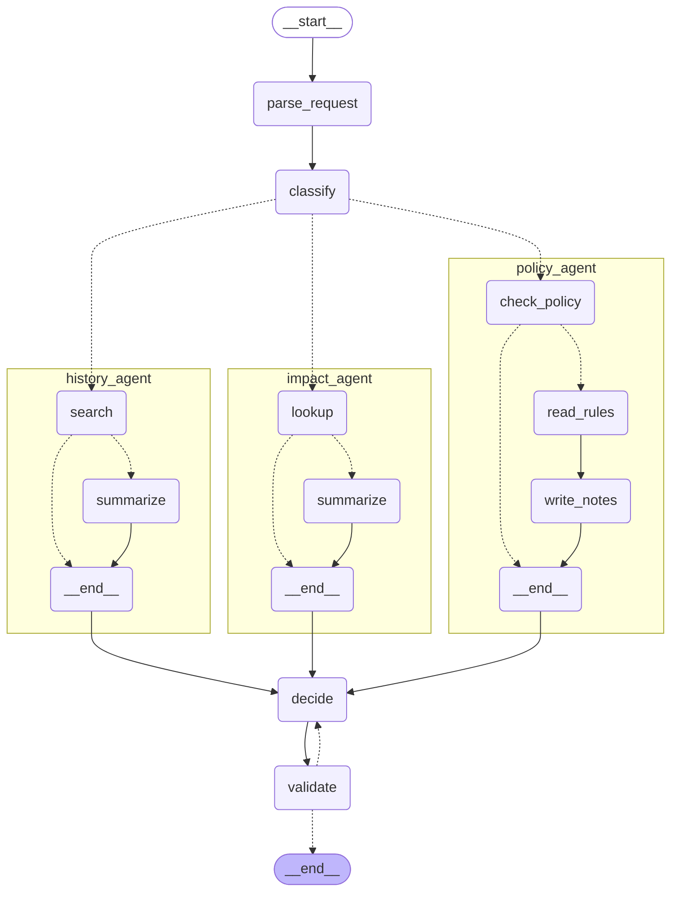

# 6단계 보고: v2 (이력 RAG, Validator)

v2는 v1에 두 가지를 더한다. 병렬 세 번째 서브에이전트 history_agent가 과거 이력을 검색해 위험도를 한 단계 올릴 근거와 유사 사례를 주고, ⑤ validate가 설명이 규칙 엔진의 결과와 모순되지 않는지 검증한다. 판정은 여전히 코드가 정하고, 이력은 판정을 바꾸지 않는다. 이 문서는 구현, dev 측정(Sonnet과 qwen3:4b), 그리고 측정에서 드러난 검증자 입력 문제의 1차 → 수정 → 2차를 정리한다.

## 이번 단계에서 한 것

| 항목 | 결과 |
|---|---|
| RAG 기반 (`app/rag/`) | `VectorStore` 인터페이스 뒤의 numpy 전수 코사인 검색, 임베딩(Ollama bge-m3는 CPU, 테스트는 Fake), 색인 `meta.json`으로 오래된 색인 감지, `sh/build_index.sh` |
| MCP `search_history` (Tool 6개째) | 기본은 필터 없는 의미 검색, 선택 인자(서비스/유형/outcome)를 주면 그 조건의 이력만 대상으로 순위 |
| history_agent | 컴파일된 서브그래프(`search` → `summarize`). 정확 일치 검색과 의미 검색을 동시에 부르는 하이브리드, `has_similar_incident`는 코드가 이력 전체에서 판단 |
| decide | `has_similar_incident`로 위험도 +1(최대 높음), `similar_history`. 이력 지시는 `decide_history.md` 조각으로 v2 경로에만 붙는다(v1 프롬프트 불변) |
| validate | 코드 검사 + main 모델 일관성 검사, 재작성 최대 1회, 두 번째 실패면 "근거 검증 미완료" 경고로 진행 |
| v2 그래프, 하네스 | `GK_VERSION=v2` 한 줄로 전환. 하네스가 RAG 검색 결과와 Validator 카운터를 기록하고, v2는 색인과 임베딩이 준비됐는지 LLM 호출 전에 확인 |
| dev 측정 | Sonnet v2 1차 → 검증자 수정 → 2차, qwen3:4b v2(같은 `num_ctx` 10240) |

## 테스트 결과

- `pytest -q` → **819 통과**, 1 skip, 21 deselect(`-m llm` 전용). 5단계 마무리 시점 692 → 6단계 구현 815 → 검증자 입력 수정 +4(819).
- `pytest -q -m llm -k anthropic이_직접_보내는_스키마를_받아들인다` → 9 통과. 새 LLM 출력 스키마 `HistoryNote`, `ValidationCheck`는 선택 필드 0개라 Anthropic 네이티브 구조화 출력이 그대로 받아들인다.
- 실제 bge-m3로 색인하고 dev 질의로 검색하는 live 확인(`tests/test_rag_live.py`): 100건을 20.5초에 색인했고, 순수 의미 검색 재현율@3은 dev 정답 5/5, 하이브리드도 5/5였다. 의미 검색에서 REQ-D03의 정답은 3위, REQ-D08은 2위였는데 하이브리드는 둘 다 맨 앞에 둔다.
- 검증자 입력 수정의 새 테스트 4건: 근거 자료 내용, 방화벽 대안 자료, 표준 변경 경로, 검증 LLM이 실제로 자료를 받는지.
- 가운뎃점 없음. `.env`와 jsonl은 git 추적 대상이 아니다.

## v2 구조도

`build_graph("v2").get_graph(xray=True).draw_mermaid()`의 출력이다(컴파일만, LLM과 MCP는 호출하지 않음). 점선은 조건부 간선이다. classify 뒤에서 세 서브에이전트가 병렬로 갈라지고(표준 변경은 policy_agent만) decide에서 합친다. validate가 실패하면 decide로 한 번 돌아간다.

## dev 평가

### 측정 조건

- Sonnet: `--provider anthropic`, main `claude-sonnet-5-5`, 분류 `claude-haiku-5-5`, Judge `claude-opus-5-5`(독립), LangSmith 추적, 10건 x 1회.
- qwen3:4b: `--provider ollama --no-judge`, `MODEL_MAIN=qwen3:4b`, `MODEL_SMALL=qwen3:0.6b`, `OLLAMA_NUM_CTX=10240`. v0, v1과 같은 값이다. 측정 중 Ollama의 `/api/ps`로 qwen3:4b가 100% GPU(3,990MB), bge-m3는 VRAM 0(CPU)임을 확인했다. 세 summary 모두 잘림 의심 0건이다.
- 모든 v2 측정은 작업 폴더가 깨끗한 상태에서 돌렸다(summary의 dirty 표시 없음).
- **decide 프롬프트가 Sonnet v0, v1 측정과 한 줄 다르다.** v0, v1 2차 측정은 "근거 없는 예시 금지" 지시(`ac59b53`) 이전의 코드다. v2 측정은 그 이후다. 대안 품질은 4.83으로 같았지만 이 차이는 비교의 한계로 둔다.

### Sonnet: v0 / v1 / v2 (1차, 2차)

| 지표 | Sonnet v0 | Sonnet v1 2차 | Sonnet v2 1차 (검증자 수정 전) | Sonnet v2 2차 |
|---|---|---|---|---|
| git 커밋 | f239b5d | 9915159 | 8fe3fbb | 3c2e95b |
| 판정 정확도 | 100.0% | 100.0% | 100.0% | 100.0% |
| 위반 P / R / F1 | 100% / 100% / 100% | 100% / 100% / 100% | 100% / 100% / 100% | 100% / 100% / 100% |
| 구조화 정확도 | 100.0% | 100.0% | 100.0% | 100.0% |
| 환각 / 오인용 / 엄격 | 0 / 0 / 3 | 0 / 0 / 3 | 0 / 0 / 3 | 0 / 0 / 3 |
| 위험도 일치 (n=8) | 87.5% | 87.5% | **100.0%** | **100.0%** |
| RAG 재현율@3 (하이브리드) | - | - | 100.0% | 100.0% |
| 판정-위반 자기모순 | 0.0% (0/10) | 0.0% (0/10) | 0.0% (0/10) | 0.0% (0/10) |
| 대안 품질 (n=6) | 4.83 | 4.83 | 4.83 | 4.83 |
| 지연 평균 / p95 (초) | 11.3 / 15.5 | 12.9 / 19.5 | 39.2 / 98.1 | 19.6 / 27.2 |
| 토큰/실행 입력 + 출력 | 15,029 + 1,445 = 16,474 | 18,214 + 1,374 = 19,588 | 31,786 + 3,752 = 35,538 | 25,788 + 1,972 = 27,760 |
| LLM 호출/실행 | 1.0 | 4.5 | 7.9 | 6.7 |
| Validator 재작성 / 미완료 | 0 / 0 | 0 / 0 | **8 / 7** | **2 / 0** |
| 오류 실행 | 0/10 | 0/10 | 0/10 | 0/10 |

읽는 법:

- **v2가 사는 것**: 위험도 일치 87.5% → 100%. REQ-D03(billing-db 컬럼 추가)이 같은 서비스와 같은 유형의 장애 이력(HIS-034, 테이블 락)이 있어 중간에서 높음으로 올라 라벨과 맞는다. 판정, 위반, 구조화는 v0, v1과 같고 이력은 판정을 바꾸지 않는다.
- **v2가 치르는 값(2차 기준, v1 2차 대비)**: 지연 평균 12.9초 → 19.6초(+52%), 토큰 +42%, LLM 호출 4.5회 → 6.7회. 호출은 history_agent 요약과 validate가 더한 것이다. 한 줄로: 판정 정확도가 이미 100%인 이 dev에서 v2의 이득은 위험도 한 건이고, 비용은 지연 +52%, 토큰 +42%다.
- **RAG 재현율@3은 100%(5/5)이지만 이 dev로는 하이브리드의 이점이 보이지 않는다.** 순수 의미 검색 상위 3건의 재현율(진단 값, `semantic_ids`)도 세 측정 모두 5/5로 같다. 하이브리드의 이점(정확 일치를 먼저 두므로 의미 검색 순위나 임베딩 모델에 좌우되지 않음)은 live 확인에서 정답이 2, 3위로 밀리는 사례로만 보였다.

### 1차 → 수정 → 2차: 검증자가 근거 없다고 지적한 것들

1차(`8fe3fbb`)에서 Validator가 10건 중 8건에 재작성을 요청했고 7건이 "근거 검증 미완료" 경고로 끝났다. 판정은 영향이 없었지만 경고가 붙고 decide가 헛되이 다시 돌아 지연이 39.2초, 호출이 7.9회로 늘었다. 경고에 남은 사유를 읽어 보니 원인은 검증 LLM의 입력이었다.

- 검증 LLM에게 판정, 위반, 설명, 대안만 보냈다. 설명이 정당하게 쓴 영향도(의존 서비스), 유사 장애 이력과 교훈, 위험도 상향, 작업 구간, 파트너 IP, 허용 기한 최대 일수를 모두 "입력에 없는 근거 없는 주장"으로 지적했다(예: "입력에는 그런 과거 이력이 없다", "입력에는 영향도 요약이나 의존 서비스 정보가 없다").
- 수정(`3c2e95b`): 검증자에게도 decide가 설명을 쓸 때 본 것과 같은 "근거 자료"(요청 대상과 등급, 작업 구간, 구조화된 요청, 영향도 요약, 조항별 설명, 유사 장애 이력과 상향 여부, 대안 작업 시각, 방화벽 대안이면 등록 파트너 출발지와 최대 일수)를 준다. `validate.md`는 근거로 삼아도 되는 것과 모순으로 볼 것을 구분해 알려 준다.
- 2차(`3c2e95b`): 재작성 8 → 2, 미완료 7 → 0, 지연 39.2초 → 19.6초, 호출 7.9회 → 6.7회, 토큰 35.5k → 27.8k. REQ-D01 한 건은 98.1초에서 24.1초가 됐다. 지연 차이에는 API 지연의 변동도 섞여 있다.
- 1차의 재작성 8건은 모두 입력 부족이 낳은 오탐이었다. 2차의 남은 재작성 2건(REQ-D04, REQ-D06)은 통과한 재작성이라 사유를 기록하지 않아서, 진짜 모순이었는지 오탐이었는지 확인하지 못했다. **이 dev에서 Validator가 실제 모순을 잡은 사례는 아직 확인하지 못했다.** 검증자의 가치는 이 측정으로는 입증되지 않았고, 비용만 확인됐다.

### 로컬 모델 축: qwen3:4b v0 / v1 / v2

| 지표 | qwen3:4b v0 | qwen3:4b v1 | qwen3:4b v2 |
|---|---|---|---|
| num_ctx | 10240 | 10240 | 10240 |
| git 커밋 | 08335a2 | cdf34ae | 968d033 |
| 판정 정확도 | 40.0% | 80.0% | 80.0% |
| 위반 P / R / F1 | 0.0% / 0.0% / 0.0% | 76.9% / 83.3% / 80.0% | 76.9% / 83.3% / 80.0% |
| 구조화 정확도 | 81.2% | 83.5% | 85.0% |
| 환각 / 오인용 / 엄격 | 0 / 5 / 7 | 0 / 3 / 5 | 0 / 3 / 5 |
| 위험도 일치 (n=8) | 25.0% | 87.5% | **100.0%** |
| RAG 재현율@3 (하이브리드) | - | - | 100.0% |
| 판정-위반 자기모순 | 30.0% (3/10) | 0.0% (0/10) | 0.0% (0/10) |
| 지연 평균 / p95 (초) | 11.2 / 16.7 | 65.9 / 91.5 | 81.4 / 111.6 |
| 토큰/실행 입력 + 출력 | 7,251 + 451 = 7,702 | 10,988 + 782 = 11,770 | 13,061 + 936 = 13,997 |
| LLM 호출/실행 | 1.0 | 5.1 | 7.1 |
| Validator 재작성 / 미완료 | 0 / 0 | 0 / 0 | 0 / 0 |
| 재시도 카운터 합 (validator 제외) | 0 | 9 | 7 |
| 잘림 의심 / 오류 실행 | 0 / 0 | 0 / 0 | 0 / 0 |

읽는 법:

- **v2는 v1과 같은 두 건을 틀린다.** 판정 정확도 80%, 위반 F1 80%가 그대로다. 틀린 건 REQ-D04(정답 자동 승인, 예측 조건부 승인: 표준 변경으로 확정되지 않아 일반 배포 조항 CHG-04/05/08이 걸림)와 REQ-D10(정답 반려, 예측 자동 승인)이다. 원인이 구조화와 분류 쪽이라 이력 검색과 검증이 고칠 수 없다. Validator는 qwen3:4b에서 한 번도 재작성을 요청하지 않았다(설명은 위반 목록과 모순되지 않았다. 틀린 것은 그 앞의 입력이다).
- **v2가 더한 것**: 위험도 87.5% → 100%, 구조화 83.5% → 85.0%. 대가는 지연 +23%(65.9 → 81.4초), 토큰 +19%, 호출 5.1회 → 7.1회다.
- **REQ-D10의 자동 승인 위험은 7단계 K3로 이 사례에서는 막힌다.** 이 실행에서 REQ-D10은 분류 불일치 경고가 붙어 route가 general이 됐다. 7단계 approval_gate는 route가 standard일 때만 자동 승인을 실행하므로(K3) 이 요청은 승인자에게 간다. 단 분류 모델도 같은 오류를 내면 못 막는다. 구조화 시각과 원문의 날짜 표현을 대조하는 방어는 후보로 PROGRESS에 남겨 두었다.
- **약한 모델은 설명 문체 지시(K5)를 지키지 못한다.** qwen3:4b v2의 설명 10건 중 4건에 규정 번호가 그대로 들어 있고(REQ-D01/D04/D05/D07), 2건에 영어 표기 Tier가 더 들어 있으며, "~합니다"체가 여러 건이고 4문장 이상인 건이 7건이다(마침표 기준의 간이 계산). 문체는 평가 지표에 들어 있지 않고 검증자도 보지 않는다.
- 사후 축이고 n=10, 단일 실행이다. `OLLAMA_NUM_PARALLEL`은 기록하지 않았다.

## 핵심 코드 설명 (발표용)

1. **상향은 결정론, 사례 제시는 하이브리드 검색 (history_agent).** `has_similar_incident`("같은 서비스 + 같은 유형 + outcome 장애")는 정확 일치 필터 검색이 한 건이라도 돌려주는지로 코드가 정한다. 필터를 순위 전에 적용하므로 임베딩 모델이나 의미 검색 순위가 위험도를 흔들지 못한다. 보여 줄 사례는 정확 일치를 먼저 두고 남는 자리를 의미 검색으로 채운 상위 3건이다. LLM은 이력을 요약만 하고 위험도는 건드리지 않는다.
2. **벡터 저장소는 인터페이스 뒤에 둔다 (`VectorStore`).** 100건은 전수 코사인 검색이 근사 오차 0이고 의존성이 없다. 수만 건 이상이면 ANN 저장소로 교체한다. 기본 저장소를 만드는 곳이 `default_store()` 한 곳이라 클래스 하나를 바꾸면 된다. `where` 필터는 순위를 매기기 전에 적용한다.
3. **오래된 색인은 조용히 틀리지 않고 멈춘다.** `meta.json`에 임베딩 모델, `history.json` 해시, 건수를 남기고 어긋나면 `INDEX_NOT_READY`로 멈춘다. 평가 하네스도 v2를 돌리기 전에 색인과 임베딩이 준비됐는지 LLM 호출 전에 확인한다. 색인이 없으면 history_agent가 조용히 "확인 불가"로 끝나서 v2가 이력 없이 v1처럼 측정되기 때문이다.
4. **임베딩은 CPU로 돌린다.** 6GB VRAM에서 LLM과 임베딩 모델이 GPU를 두고 서로를 밀어내지 않게 하려는 것이다. qwen3:4b v2 측정 중 Ollama의 `/api/ps`로 qwen3:4b가 100% GPU를 유지함을 확인했다.
5. **이력 지시는 별도 프롬프트 조각이다 (`decide_history.md`).** history_agent가 돈 경로에서만 시스템 프롬프트 뒤에 붙는다. v1의 프롬프트와 입력이 한 글자도 바뀌지 않아 기존 v1 측정이 그대로 유효하다.
6. **검증은 코드가 먼저, LLM은 그다음이다 (validate).** 위반 목록, 판정, 인용 조항, 설명이 언급한 조항 번호를 코드가 대조하고, 실패하면 LLM을 부르지 않는다. LLM 검사는 `MODEL_JUDGE`가 아니라 main 모델로 한다(Judge는 평가 전용이다). 재작성은 한 번만 하고, 두 번째도 실패하면 막지 않고 "근거 검증 미완료" 경고를 붙여 승인자에게 넘긴다. 검증 LLM 호출이 실패해도 막지 않는다.
7. **검증자도 작성자가 본 근거를 봐야 한다.** 판정과 설명만 주면 정당한 사실을 근거 없다고 지적한다(1차에서 10건 중 7건이 "미완료"). 이제 decide와 같은 근거 자료를 주고, 어디까지 근거로 삼아도 되는지 프롬프트가 알려 준다.
8. **새 LLM 출력 스키마는 선택 필드 0개다.** Anthropic 구조화 출력은 선택 필드가 있는 스키마를 복잡도 한도로 거절한 적이 있다(4단계 J2). `HistoryNote`와 `ValidationCheck`는 처음부터 필수 필드만 두고 복잡도 테스트와 live 수락 테스트로 고정했다.

## 알아 둘 점

- dev는 n=10, reps=1이고 anthropic은 temperature를 보내지 않아 비결정론이다. 1차와 2차의 지연 차이에는 검증자 수정 외에 API 지연의 변동이 섞여 있다. 이 측정은 dev의 확인이지 최종 결과가 아니다. 9단계에서 eval 20건 x 3버전 x 3회로 일관성과 비용까지 본다.
- Sonnet 판정 정확도가 v0, v1, v2 모두 100%라 이 dev로는 버전을 정확도로 가르지 못한다. v2의 이득은 위험도 8건 중 1건씩이다(Sonnet은 REQ-D03, qwen3:4b는 87.5% → 100%).
- Validator가 실제 모순을 잡은 사례는 dev에서 확인하지 못했다. 1차의 재작성 8건은 모두 입력 부족이 낳은 오탐이었고, 2차의 재작성 2건은 사유를 남기지 않아 판단하지 못했다. 통과한 재작성의 사유도 dev 기록에 남기는 방안이 후보다.
- Haiku에서 근거 없는 예시를 막는 지시(`ac59b53`)의 효과는 Haiku로 다시 재지 않아 확인하지 못했다. Sonnet v2 측정은 이 지시 뒤의 코드다.
- 대안 문장 끝의 고정 문구와 말투 혼재는 그대로다.
- 하이브리드 검색의 이점은 이 dev의 정답(모두 "같은 서비스 + 같은 유형 + 장애")으로는 보이지 않는다. 지표가 정확 일치 단계가 만드는 값에 가깝고 구조상 높아서 순수 의미 검색 재현율을 진단 값으로 따로 적었다.
- 위 표는 summary JSON에서 스크립트로 뽑았다(손으로 옮기지 않음). 스크립트는 저장소에 넣지 않았다. 이번 세션은 시스템 메모리 부족으로 백그라운드 측정이 한 번 중단됐고(Sonnet 1차는 끝난 뒤, qwen3:4b가 시작하자마자), 이후 Sonnet 2차와 qwen3:4b를 하나씩 따로 돌렸다. 중단된 실행은 기록이 남지 않았다.

## 커밋 분할 목록

### 6단계 계획과 구현

| 해시 | 메시지 | 파일 |
|---|---|---|
| `f70720d` | docs: 6단계 계획 (v2: RAG, Validator) | docs/plans/stage6.md |
| `7761f10` | feat(rag): 벡터 저장소 인터페이스와 numpy 구현, 임베딩, 이력 색인 | app/rag/, scripts/build_index.py, sh/build_index.sh, app/config.py, requirements.txt, tests/conftest.py, tests 3개 |
| `5158e56` | feat(mcp): search_history Tool과 타입이 있는 클라이언트 | app/mcp_server/models.py, server.py, app/agent/mcp_client.py, tests/_history.py, tests 2개 |
| `6b204d4` | feat(agent): history_agent 서브그래프와 이력 상향 근거(has_similar_incident) | nodes/history_agent.py, prompts/history_agent.md, state.py, tests 3개 |
| `adf08a1` | feat(agent): decide가 이력 상향과 similar_history를 반영한다 | nodes/decide.py, prompts/decide_history.md, tests/test_decide.py |
| `503e777` | feat(agent): validate 노드 (코드 검사, main 모델 일관성 검사, 재작성 1회) | nodes/validate.py, prompts/validate.md, results.py, state.py, nodes/decide.py, tests 3개 |
| `5d9da07` | feat(agent): v2 그래프 조립 | app/agent/graph.py, tests/test_graph_v2.py, tests 3개 |
| `cc384a8` | feat(eval): 하네스가 RAG 검색 결과와 Validator 카운터를 기록한다 | eval/harness.py, eval/report.py, app/agent/prompting.py, app/rag/index.py, tests 4개 |
| `5039b4f` | fix(sh): build_index.sh가 ollama CLI 없이도 Windows에서 돌도록 | sh/build_index.sh |
| `ed406f2` | test(rag): 실제 bge-m3로 색인하고 dev 질의로 검색하는 live 확인 | tests/test_rag_live.py |
| `8fe3fbb` | docs: 6단계 설계 결정을 SPEC과 EVAL에 반영 | docs/SPEC.md, docs/EVAL.md |

### 측정과 검증자 입력 수정

| 해시 | 메시지 | 파일 |
|---|---|---|
| `bf06d78` | chore(eval): v2 dev 측정 결과 (anthropic sonnet), 1차 | results summary 1개 |
| `3c2e95b` | fix(agent): 검증자에게 decide가 본 근거 자료를 함께 준다 | nodes/validate.py, prompts/validate.md, tests/test_validate.py |
| `968d033` | chore(eval): v2 dev 측정 결과 (anthropic sonnet 2차, 검증자 근거 자료 수정 후) | results summary 1개 |
| `b453e44` | chore(eval): v2 dev 측정 결과 (ollama qwen3:4b, --no-judge, 검증자 근거 자료 수정 후) | results summary 1개 |

### 같은 배치의 앞쪽 작업 (5단계 후속)

`ac59b53` 근거 없는 예시 금지, `08335a2` EVAL 로컬 모델 축, `cdf34ae`/`c404ec5` qwen3:4b v0/v1 측정, `2d063a2` ollama 리포트 모델별 절, `0d6da24` 로컬 축 기록. 자세한 내용은 `docs/reports/stage5.md`.
