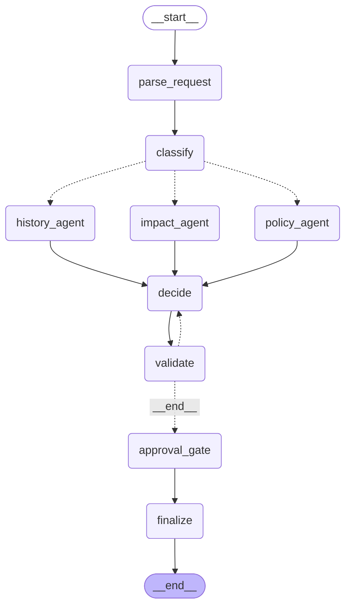

# 7단계 보고: 사람 승인(HITL)과 API

그래프 끝에 사람 승인(`approval_gate`, `finalize`)을 `interrupt()`와 SQLite 체크포인터로 붙이고, `docs/API_CONTRACT.md`의 엔드포인트 6개와 SSE를 FastAPI로 구현해 화면(`web/`)과 실제로 연결했다. 평가 하네스의 그래프는 승인 없이 ⑥ 직전에서 끝나는 지금 모양 그대로다(측정 지점 유지). 계획은 `docs/plans/stage7.md`(승인됨, 7번의 3번은 사용자 수정)다.

## 이번 단계에서 한 것

| 항목 | 결과 |
|---|---|
| 체크포인터 (`app/persistence/`) | SQLite 팩토리, 직렬화 허용 목록을 부모와 서브그래프 상태 스키마에서 자동 수집, thread 목록 |
| `approval_gate`, `finalize` | 자동 승인은 route가 standard이고 판정이 자동 승인일 때만(K3), 그 밖은 `interrupt()`. 감사 로그 JSON Lines |
| `build_graph` 선택 인자 | `checkpointer`, `audit`, `approval`. 인자를 안 주면 7단계 전과 같은 그래프(노드와 엣지 불변을 테스트로 고정) |
| FastAPI (`app/api/`) | 엔드포인트 6개, SSE, lifespan 싱글턴, 역할 `Depends`, 마스킹 미들웨어, 계약 모양의 오류 응답, CORS |
| 요청 저장소와 복구 | 체크포인터가 원천, 서버가 뜰 때 훑어 복구. 실행 도중 꺼진 요청은 수동 검토로 닫음 |
| 설정 | `GK_AUDIT_LOG`, `GK_WEB_ORIGINS`, `GK_RUN_TIMEOUT_S`. 의존성 5개(`fastapi`, `langgraph-checkpoint-sqlite`, `aiosqlite` 등) |
| 실제 연결 | Sonnet(v2) 서버 + 화면(목업 끔)으로 요청부터 반려 처리까지 확인 (아래) |

## 테스트 결과

- `pytest -q` → **976 통과**, 1 skip, 21 deselect(`-m llm` 전용). 6단계 끝 819에서 +157.
- 새 테스트: `test_config` +5(15), `test_checkpointer` 9, `test_audit` 9, `test_approval_gate` 17, `test_finalize` 4, `test_graph_approval` 11, `test_api_foundation` 29, `test_api_events` 8, `test_api_views` 21, `test_api_runner` 14, `test_api` 30.
- 타이밍에 기대는 테스트(제한 시간, 서버 종료 모사, 병렬 순서)는 `test_api`와 `test_api_runner`를 3회, `test_api_runner`와 `test_api_events`를 4회 반복해 흔들리지 않는 것을 확인했다.
- 가운뎃점 없음. `.env`, `.data/`, jsonl은 git 추적 대상이 아니다.
- 허용 목록 보호 테스트는 수집 대상을 `GKState`만으로 줄이면 실패하는 것을 확인했다(아래 "찾아서 고친 것").

## 그래프 끝 구조

`build_graph("v2", approval=True)`의 최상위 Mermaid다(서브그래프 내부는 6단계 보고서 참고). `validate`의 조건부 간선 중 라벨 `__end__`는 "검증을 마쳤다(통과 또는 미완료)"는 뜻이고 `approval_gate`로 이어진다. 평가용 그래프(인자 없음)는 이 간선이 `__end__`로 간다.

## 실제 연결 확인

`LLM_PROVIDER=anthropic GK_YES=1 bash sh/run_api.sh`(v2, main `claude-sonnet-5-5`, 시작할 때 RAG 색인과 임베딩 확인 통과)와 `bash sh/run_web.sh`(목업 끔, Vite 프록시)를 띄웠다. Sonnet 요청은 3건이다(API 수준 2건, 화면 1건).

**1. API 수준 (Vite 프록시 5173 경유, REQ-D01 문장)**

- 요청 후 **30.3초**에 승인 대기. SSE 이벤트가 2.0, 6.2, 7.9, 10.8, 13.9, 25.5, 30.0초에 나뉘어 도착해 프록시가 버퍼링하지 않는다(`Cache-Control: no-cache`, `X-Accel-Buffering: no`).
- 이벤트 순서: parse_request, classify, history/impact/policy 세 노드의 시작이 먼저, 종료는 따로(10.8, 11.1, 13.9초), decide(11.6초), validate(4.5초), recommendation, approval_gate 시작, awaiting_approval.
- 응답을 계약의 키 집합과 대조했다(요청 접수, 상세, structured, recommendation, violation, 노드, alternative_diff 항목, impact, 비슷한 사고, 결재함 요약, 결정 응답, approval, SSE의 node_started/recommendation/awaiting_approval/done). **어긋난 키 없음**.
- 요청자의 decision은 403(계약의 오류 모양), 승인자의 반려는 200. 결정 뒤 SSE에 재연결하면 `awaiting_approval ... done`까지 받는다.
- **서버를 강제 종료했다가(프로세스 트리 kill) 다시 띄웠다.** 승인 대기였던 REQ-0002가 그대로 남았고(결재함, 권고 "승인"), SSE는 종료 이벤트 `awaiting_approval` 하나로 닫혔고, 재시작 뒤 승인(200)이 이어졌다. 재시작 전에 반려한 REQ-0001도 그대로다. 재시작한 서버의 로그에 경고가 없었다.
- 감사 로그에는 `forbidden` 2건(헤더 없는 호출, 요청자의 decision 시도)과 `decision`(반려, 승인)이 남았다.

**2. 화면 (Chrome, 목업 끔)**

REQ-D01 문장을 입력해 "검토 요청하기" → 진행 타임라인(요청 이해, 분류, 규정/영향/사고 사례 세 갈래 동시에 진행, 결과 정리) → 결과 화면(**반려 권고**, 위험도 높음, 비슷한 사고, "이렇게 고쳐 주세요" 카드 3개 = `alternative_diff`, 진행 단계 "승인자 확인 중") → 승인자로 전환 → 결재함 "결재 대기 1건"과 상세(시스템 설명, 반려 이유, 영향 범위, 비슷한 사고, 요청자에게 제안한 대안) → 사유를 적고 **반려하기** → "반려했어요 / 박CAB / 사유", 결재 대기 0건 → 요청자 화면에서 "반려됨"과 사유, 진행 단계 "박CAB가 반려했어요". 브라우저 콘솔에 오류가 없고 `/api/requests/REQ-0003`은 200이었다.

**계약과 어긋난 곳**: 키 수준과 화면 동작 모두 찾지 못했다. 계약이 정하지 않았던 곳은 구현하며 해석을 정해 `docs/API_CONTRACT.md`의 "7단계 구현에서 확정한 해석"에 적었다(자동 승인의 `approval`은 null, 재작성 때 노드 이벤트 반복, 결정 뒤 재연결은 done까지, 재시작 뒤에는 종료 이벤트 하나 등). 계약 문장을 바꾼 것은 사용자 결정 한 건뿐이다: 상세 응답의 `text`는 이번에 새로 쓴 본문만이다(재요청이어도 부모 본문 없음).

**데모 때 알아 둘 점**: "이번 주 금요일"은 실제 접수 날짜 기준이라 오늘(10/21)에는 10/23이 되어 동결(10/30~11/2)에 걸리지 않는다. 그래서 라이브 결과의 위반은 CHG-01/02/03/09이고 CHG-10은 없다(dev 정답의 접수일은 10/29라 CHG-10이 있다). 동결까지 걸리는 시연을 하려면 "이번 주 금요일"이 10/30이 되는 주(10/26 월요일부터 10/30 금요일 사이에 접수)여야 한다.

## 찾아서 고친 것

- **직렬화 허용 목록이 서브그래프 상태를 빠뜨렸다** (`3fba3fe`). 통합 테스트에서 서버를 다시 띄울 때 `Blocked deserialization of ... PolicyCheckResult / ServiceInfo / CalendarResult / HistoryHit`이 났다. 서브에이전트가 컴파일된 서브그래프라 자기 상태(Tool 원본)도 같은 thread의 체크포인터에 저장되는데, 허용 목록을 `GKState`에서만 모았기 때문이다. 명시적인 허용 목록은 목록 밖의 타입을 막으므로 빠뜨리면 값이 조용히 사라진다. 서브그래프 상태 스키마를 더해 고쳤고, 부모와 서브그래프의 모든 체크포인트를 읽어 경고가 없는지 보는 테스트를 더했다.
- **재시작 뒤에 결정한 요청의 재연결이 부분 타임라인을 보냈다.** 복구한 요청은 이벤트 기록이 중간부터만 있어서 계약("재시작 뒤에는 종료 이벤트 하나")과 달랐다. 복구한 요청은 다시 보내지 않도록(`replayable=False`) 했다.
- **`run_api.sh`가 Windows에서 키가 있는데도 없다고 멈췄다** (`2c1532c`). `python.exe`가 줄 끝에 `\r`을 붙여 `HAS_KEY`가 "yes\r"이 됐다. `build_index.sh`와 같은 원인이라 `tr -d '\r'`로 고쳤다.
- 통합 테스트에서 fake LLM 응답 큐가 전역이라 앞 요청이 끝나기 전에 다음 응답을 넣으면 `FakeResponsesExhausted`가 났다. 요청을 하나씩 끝까지 기다리게 고쳤다(테스트 설계 문제).

## 핵심 코드 설명 (발표용)

1. **승인 대기는 체크포인터에 저장된 그래프 상태다 (`interrupt()`와 SQLite).** `approval_gate`가 `interrupt()`로 멈추면 상태가 SQLite에 저장되고, 서버를 다시 띄워도 같은 `thread_id`(= `request_id`)로 재개한다. 메모리에만 두면 서버가 꺼질 때 승인 대기가 사라진다. 실제로 서버를 강제 종료해도 승인 대기가 남았다. 재개하면 노드가 처음부터 다시 실행되므로 `interrupt()` 앞에는 부작용을 두지 않는다.
2. **자동 승인은 route가 standard일 때만이다 (K3).** 판정은 엔진이 정한 값이지만, 그 값이 틀린 분류나 잘못 읽은 시각에서 나왔을 수 있다. 작은 모델과 분류가 어긋난 표준 변경은 판정이 자동 승인이어도 승인자에게 간다. 승인자를 거치지 않는 방향의 오류가 가장 위험하기 때문이고, 6단계 측정의 qwen3:4b REQ-D10(잘못된 자동 승인) 사례가 이 경로로 막힌다.
3. **진행 상태의 원천은 체크포인터 하나다.** 요청 저장소는 체크포인터에 없는 것(요청자, 제출 시각, 이번 본문, 이벤트 기록, task)만 메모리에 두고, 요약과 상세는 항상 체크포인터를 읽는다. 원천이 둘이면 서로 어긋난다. 서버가 뜰 때 한 번 훑어 복구하고, 실행 도중 꺼진 요청은 자동으로 다시 돌리지 않고 수동 검토로 닫는다(LLM 비용과 중복 실행 위험).
4. **lifespan에서 싱글턴을 한 번만 만든다.** MCP 서브프로세스, 그래프 compile, SQLite 연결은 비싸거나 하나만 있어야 하는 것들이라 서버가 뜰 때 만들어 `Container`로 묶고 역순으로 닫는다. 체크포인터 연결이 갈라지면 `interrupt` 상태가 갈라진다. v2는 이력 색인과 임베딩이 준비되지 않았으면 서버를 띄우지 않는다(색인이 없으면 조용히 이력 없는 v1처럼 동작하기 때문).
5. **역할 확인은 미들웨어가 아니라 `Depends`다.** 권한이 라우트 시그니처에 드러나고 OpenAPI에 보이며, 테스트가 `dependency_overrides`로 바꿔 끼울 수 있고, 경로 문자열 매칭에 기대지 않아 새 라우트가 권한 없이 열리는 실수가 줄어든다. 승인자와 결정 시각은 본문이 아니라 헤더와 서버 시각으로 채워 클라이언트가 승인자를 지정하지 못한다.
6. **마스킹은 앞에서 한다 (ASGI 미들웨어).** `/api/` JSON 본문의 문자열 값을 핸들러가 보기 전에 가려서 원문이 핸들러, 상태, LangSmith, 감사 로그 어디에도 도달하지 않는다. 그래서 `raw_text`를 상태에 두지 않는다. 오류 응답도 입력값을 되돌려 주지 않는다(FastAPI 기본 422는 입력을 싣는다).
7. **실행과 SSE 연결은 분리하고, replay와 라이브는 한 루프다.** 러너가 LangGraph의 `tasks` 스트림(최상위 노드의 시작과 종료)을 계약의 이벤트로 바꿔 기록에 쌓고, 스트림 엔드포인트는 인덱스를 따라 읽는다. 연결 직전의 이벤트를 놓치지 않고, 연결이 끊겨도 실행은 계속된다. `awaiting_approval`은 기록의 마지막일 때만 스트림을 닫아서 결정 뒤에 연결하면 `done`까지 받는다.
8. **`alternative_diff`는 코드가 계산한다.** 위반한 조항이 고칠 필드를 정하고 값은 엔진이 검증한 일정(`state.alternative`)과 rules.json에서 채운다. LLM의 대안 문장은 읽지 않는다. 화면에 보이는 "지금에서 이렇게" 카드가 LLM이 지어낸 값이 아니게 하려는 것이다.
9. **직렬화 허용 목록은 상태 스키마에서 자동으로 만든다.** 상태에 모델을 더해도 목록을 따로 고칠 일이 없다. 명시적인 목록은 막는 쪽이라 안전하지만 빠뜨리면 값이 사라지므로, 모든 체크포인트를 읽어 경고가 없는지 보는 테스트가 빠뜨림을 잡는다.

## 알아 둘 점

- 화면 검증에서 재요청("이 내용으로 다시 요청하기")은 돌리지 않았다. 재요청은 통합 테스트(부모 본문과 합친 문장, 응답 `text`, 없는 부모 404)로만 확인했다. Sonnet 요청을 더 보내지 않으려고 했다.
- 서버 강제 종료는 승인 대기 상태에서만 라이브로 해 봤다. 실행 도중 꺼진 요청이 수동 검토로 닫히는 것은 통합 테스트로 확인했다.
- 목록은 요청 N건에 체크포인터를 N번 읽는다. 수백 건까지는 충분하고 그보다 크면 요약 표가 필요하다. 동시 실행 개수 제한은 없다. 데모는 헤더를 믿는 방식이라 실서비스는 SSO로 소유자를 확인해야 한다.
- anthropic은 temperature를 보내지 않아 같은 요청도 결과 문장이 달라질 수 있다(라이브에서 첫 요청의 대안 시각은 10:00, 화면 요청은 14:00이었다. 둘 다 엔진이 검증한 일정이다).
- 구조화 시각과 원문의 날짜 표현을 대조하는 방어는 만들지 않았다(이번 범위 밖, 제안만). K3는 분류가 어긋난 경우만 막고 분류 모델도 같은 오류를 내면 막지 못한다.
- 이번 세션도 시스템 메모리 부족으로 백그라운드 측정이 한 번 중단된 적이 있었다(6단계 보고 참고). 7단계의 실제 연결은 서버와 화면, Ollama가 함께 도는 동안 문제가 없었다.
- `run_api.sh`와 `run_web.sh`의 포트 사용 점검(`lsof`)은 Windows에 `lsof`가 없어 조용히 건너뛴다.

## 커밋 분할 목록

| 해시 | 메시지 | 파일 |
|---|---|---|
| `ea103bc` | docs: 7단계 계획 (HITL 승인과 FastAPI) | docs/plans/stage7.md |
| `31eeb73` | build(deps): API와 SQLite 체크포인터 의존성 | requirements.txt |
| `0e2e952` | feat(config): 감사 로그, CORS, 실행 제한 설정 | app/config.py, tests/conftest.py, tests/test_config.py, .env.example |
| `98fee3c` | feat(persistence): SQLite 체크포인터 팩토리 | app/persistence/, tests/test_checkpointer.py |
| `929e492` | feat(audit): 감사 로그 JSON Lines | app/audit.py, tests/test_audit.py |
| `8ed9225` | refactor: 서버 시각 유틸을 app/clock.py로 분리 | app/clock.py, app/audit.py, tests/test_audit.py |
| `a0150e2` | feat(agent): approval_gate와 finalize, build_graph 선택 인자 | app/agent/ (graph, state, results, nodes 2개), tests 4개와 tests/_graph_helpers.py |
| `646de08` | feat(api): 오류 응답, 역할 Depends, 마스킹 미들웨어 | app/api/ (errors, deps, middleware), tests/test_api_foundation.py |
| `ae2e14f` | feat(api): 요청 저장소, 이벤트 기록, 러너, 응답 변환 | app/api/ (store, events, runner, views, alternative), tests 3개 |
| `3fba3fe` | fix(persistence): 서브그래프 상태의 모델도 직렬화 허용 목록에 담는다 | app/persistence/checkpointer.py, tests 3개 |
| `fcba1d9` | feat(api): 엔드포인트 6개와 SSE, lifespan | app/api/ (routes, main, store), sh/run_api.sh, tests/test_api_runner.py |
| `c951362` | test(api): API 통합 테스트 | tests/test_api.py |
| `2c1532c` | fix(sh): run_api.sh가 Windows에서 API 키가 있는데도 없다고 멈추던 것을 고친다 | sh/run_api.sh |
| `02741f5` | docs: 7단계 구현 내용을 SPEC과 API 계약, 환경 변수 표에 반영 | docs/SPEC.md, docs/API_CONTRACT.md, CLAUDE.md |
