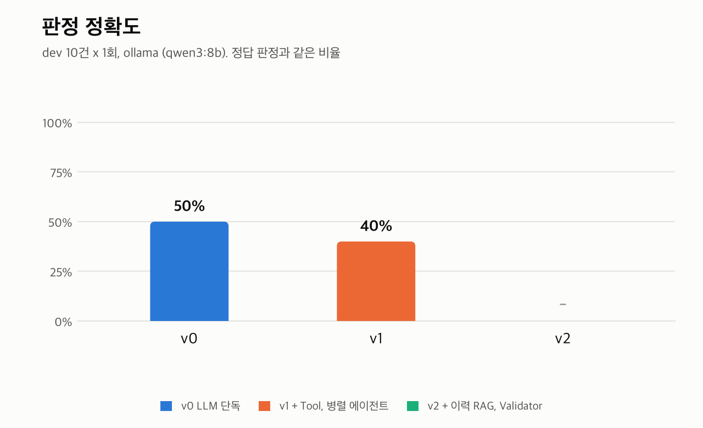
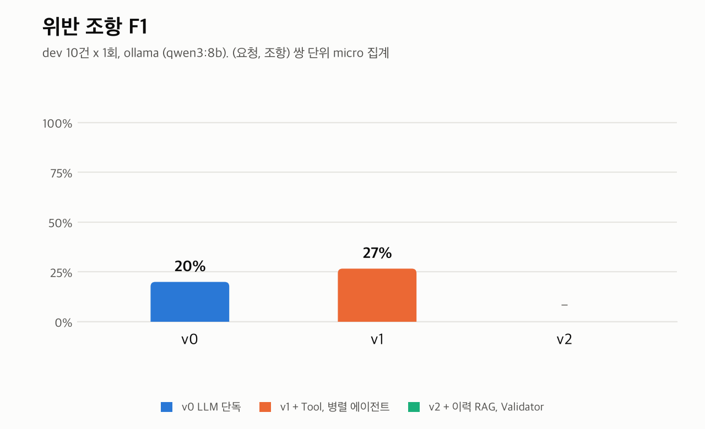
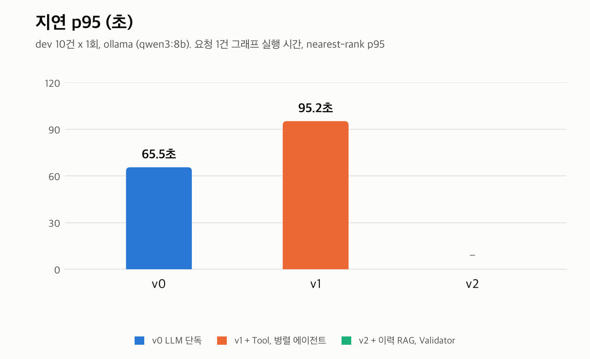
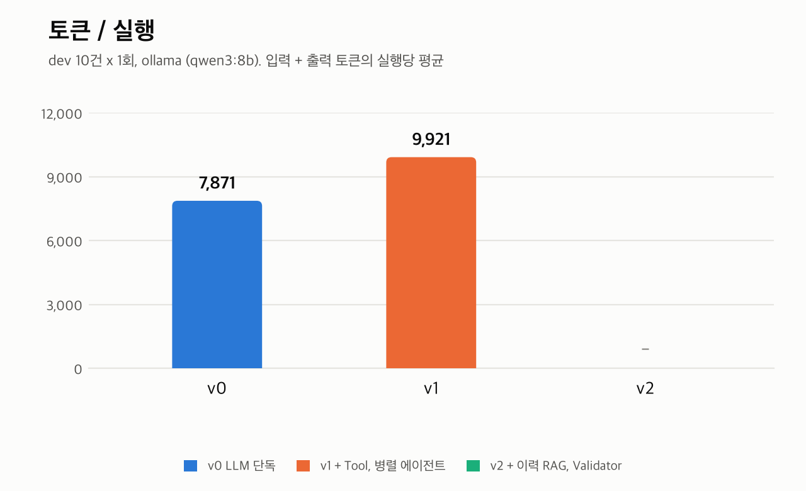
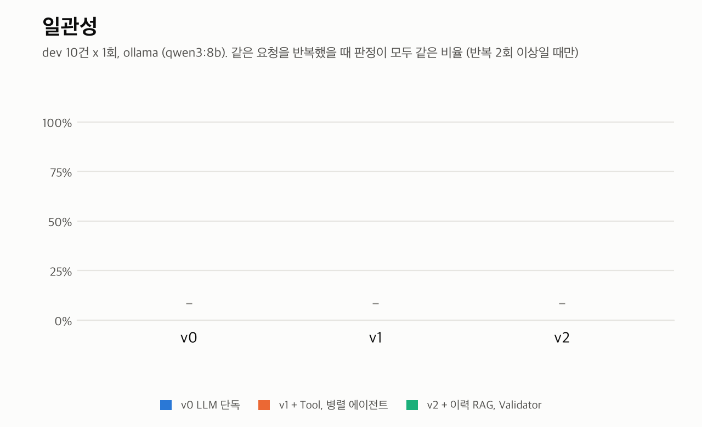
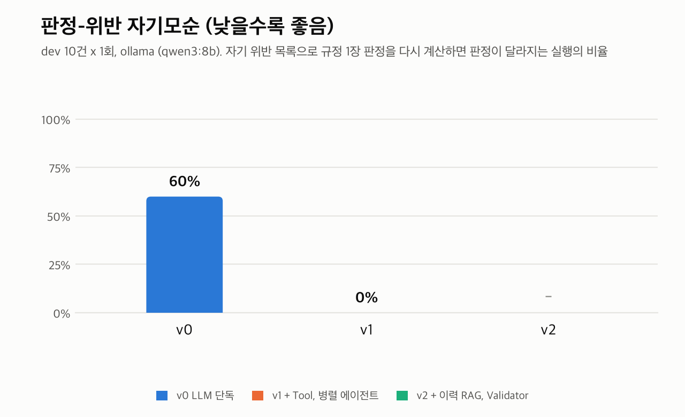

# GateKeeper 평가 리포트

생성 2026-10-21 17:47 (python eval/report.py). 원자료는 results/*.summary.json이다.

## dev 평가

provider ollama, 요청 10건 x 반복 1회. 측정한 버전: v0, v1.
각 버전의 가장 최근 실행을 쓴다.

### Before/After 표

| 지표 | v0 | v1 | v2 | 변화 (v0 → v2) |
|---|---|---|---|---|
| 판정 정확도 | 50.0% | 40.0% | - | - |
| 위반 조항 F1 | 20.0% | 26.7% | - | - |
| 일관성 (반복 간 판정 일치) | - | - | - | - |
| 판정-위반 자기모순 (낮을수록 좋음) | 60.0% | 0.0% | - | - |
| 환각 조항 수 | 0 | 0 | - | - |
| RAG 재현율@3 | - | - | - | - |
| 지연 p95 (초) | 65.5 | 95.2 | - | - |
| 토큰 / 실행 (입력 + 출력) | 7,871 | 9,921 | - | - |
| 예상 비용 / 실행 (USD) | - | - | - | - |

### 전체 지표

| 지표 | v0 | v1 | v2 |
|---|---|---|---|
| 판정 정확도 | 50.0% | 40.0% | - |
| 위반 정밀도 | 16.7% | 22.2% | - |
| 위반 재현율 | 25.0% | 33.3% | - |
| 위반 F1 | 20.0% | 26.7% | - |
| 구조화 정확도 (필드 단위) | 93.2% | 66.2% | - |
| 환각 조항 수 | 0 | 0 | - |
| 오인용 수 | 15 | 14 | - |
| 오인용 수 (엄격, 허용 목록 없음) | 18 | 15 | - |
| 위험도 일치율 | 62.5% | 62.5% | - |
| 긴급 판정 정확도 | 100.0% | 0.0% | - |
| 판정-위반 자기모순 (낮을수록 좋음) | 60.0% | 0.0% | - |
|   자기모순 실행 수 / 따진 실행 수 | 6 / 10 | 0 / 8 | - |
| RAG 재현율@3 | - | - | - |
| 일관성 | - | - | - |
| 대안 품질 (Judge 1~5) | 3.17 | 3.00 | - |
| 지연 평균 (초) | 32.7 | 50.8 | - |
| 지연 p95 (초) | 65.5 | 95.2 | - |
| 입력 토큰 / 실행 | 7,257 | 9,153 | - |
| 출력 토큰 / 실행 | 613 | 768 | - |
|   그중 reasoning 토큰 합계 | 0 | 0 | - |
| LLM 호출 / 실행 | 1.00 | 4.70 | - |
| 예상 비용 / 실행 (USD) | - | - | - |
| Validator 재작성, Tool 재시도 등 (합계) | 0 | 10 | - |
| 오류 실행 수 | 0 | 2 | - |

### 구조화 필드별 정확도

gold가 null인 restart_required, cert_expires_at은 비교에서 빠진다(괄호는 맞은 수/비교한 수).

| 필드 | v0 | v1 | v2 |
|---|---|---|---|
| target | 100.0% (10/10) | 80.0% (8/10) | - |
| change_type | 100.0% (10/10) | 40.0% (4/10) | - |
| start | 80.0% (8/10) | 70.0% (7/10) | - |
| end | 70.0% (7/10) | 60.0% (6/10) | - |
| time_precision | 80.0% (8/10) | 60.0% (6/10) | - |
| source | 100.0% (10/10) | 80.0% (8/10) | - |
| port | 100.0% (10/10) | 80.0% (8/10) | - |
| expires_days | 100.0% (10/10) | 80.0% (8/10) | - |
| expires_at | 80.0% (8/10) | 60.0% (6/10) | - |
| has_rollback | 100.0% (10/10) | 40.0% (4/10) | - |
| has_test_evidence | 100.0% (10/10) | 40.0% (4/10) | - |
| is_emergency | 100.0% (10/10) | 80.0% (8/10) | - |
| ticket | 100.0% (10/10) | 80.0% (8/10) | - |
| restart_required | 100.0% (2/2) | 100.0% (2/2) | - |
| cert_expires_at | 100.0% (1/1) | 100.0% (1/1) | - |

### 실험 메타데이터

| 항목 | v0 | v1 | v2 |
|---|---|---|---|
| 실행 시작 | 2026-10-21T14:49:48 | 2026-10-21T17:34:55 | - |
| git 커밋 | c5fd852 (dirty) | ed8c89f | - |
| main 모델 (설정) | qwen3:8b | qwen3:8b | - |
| 관측된 모델 | qwen3:8b | qwen3:0.6b, qwen3:8b | - |
| Judge 모델 (독립 여부) | qwen3:8b (비독립) | qwen3:8b (비독립) | - |
| 요청 x 반복 | 10 x 1 | 10 x 1 | - |
| 프롬프트 해시 | baseline_v0 97e78b10, structure_rules f9c5ddde, judge_prompt d57e71d5 | parse_request 262f0b10, structure_rules f9c5ddde, classify aaea34b7, policy_agent 3b8fe2da, impact_agent cad2bb14, decide c95682e7, judge_prompt d57e71d5 | - |
| OLLAMA_NUM_PARALLEL | - | - | - |
| LangSmith 추적 | gk-v0-dev-20261021-144948 | gk-v1-dev-20261021-173455 | - |
| warm-up | first_request | first_request | - |

### 참고

- p95는 nearest-rank로 계산한다. 실행이 10건이면 순위가 10번째라 n=10이면 최댓값과 같다. 표본이 작아서 수치 차이를 통계적 결론으로 읽지 않는다.
- v0, v1은 과거 이력을 받지 않아 위험도를 CMDB 등급으로만 정한다. 이력 기반 상향과 RAG 재현율은 v2의 RAG가 더하는 정보다.
- Judge 모델이 시스템 모델과 같은 실행은 대안 품질이 비독립 평가다. 단계별 추세를 보는 용도이고, 최종 평가(anthropic, opus)와 직접 비교하지 않는다.
- Ollama 서버가 요청을 한 건씩 처리하면(OLLAMA_NUM_PARALLEL=1) v1의 policy_agent와 impact_agent가 보내는 LLM 호출이 서버에서 줄을 서서 병렬의 지연 이득이 이 수치에 보이지 않는다. 최종 평가(anthropic)는 실제로 병렬이다.
- 오류 난 실행은 모든 지표에서 오답으로 센다. 오류 실행 수는 전체 지표 표에 있다.
- meta에 rescored가 있는 실행은 측정 뒤 저장된 결과(jsonl)로 지표를 다시 계산해 더했다. LLM은 다시 부르지 않았다.
- 판정-위반 자기모순은 pred 위반 목록의 구분(금지/보완)으로 규정 1장 판정을 다시 계산해 pred 판정과 다른 실행의 비율이다. v1, v2는 판정을 코드가 위반 목록에서 계산하므로 구조적으로 0이다.
- 오인용은 gold가 긴급이면 CHG-07, 표준 변경이면 해당 STD 인용을 허용한 수치이고, 허용 목록 없는 엄격 수치를 같이 적는다.
- 예상 비용은 eval/pricing.json의 단가가 채워진 모델만 계산한다. 비어 있으면 '-'이다.

### 차트

