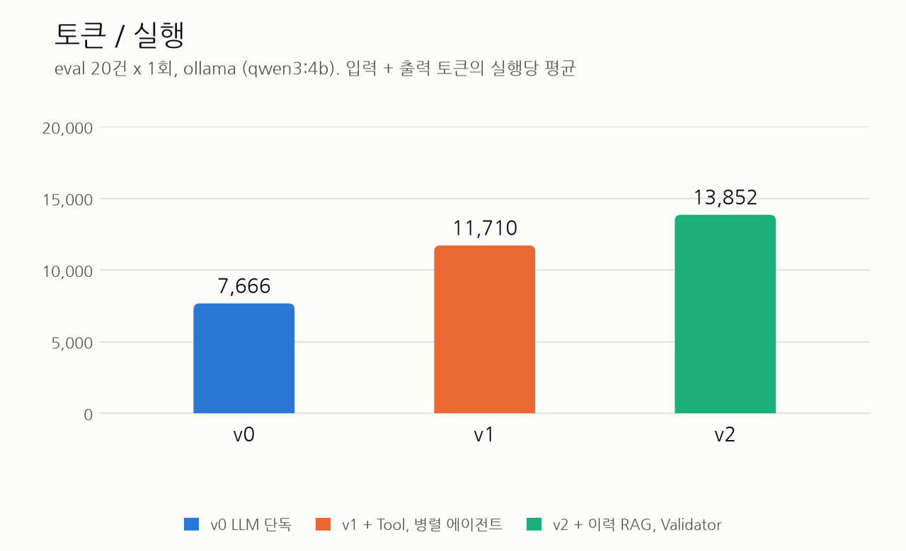
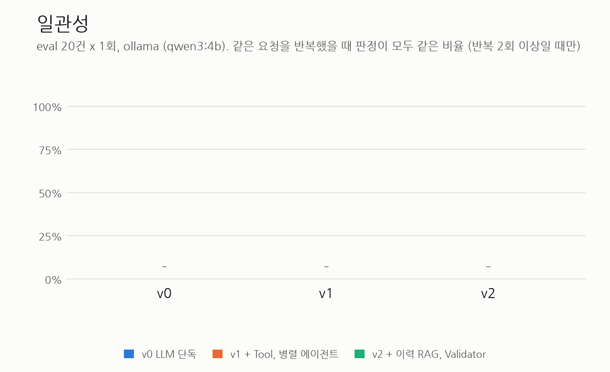
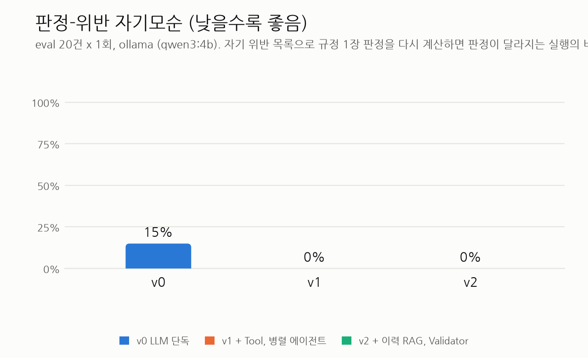

# GateKeeper 평가 리포트

생성 2026-10-22 01:06 (python eval/report.py). 원자료는 results/*.summary.json이다.

## eval 평가 (main 모델 qwen3:4b)

provider ollama, main 모델 qwen3:4b, 요청 20건 x 반복 1회. 측정한 버전: v0, v1, v2.
같은 main 모델 안에서 각 버전의 가장 최근 실행을 쓴다. main 모델이 다른 절의 수치와는 직접 비교하지 않는다.

### Before/After 표

| 지표 | v0 | v1 | v2 | 변화 (v0 → v2) |
|---|---|---|---|---|
| 판정 정확도 | 35.0% | 75.0% | 70.0% | +35.0%p |
| 위반 조항 F1 | 32.0% | 66.7% | 61.1% | +29.1%p |
| 일관성 (반복 간 판정 일치) | - | - | - | - |
| 판정-위반 자기모순 (낮을수록 좋음) | 15.0% | 0.0% | 0.0% | -15.0%p |
| 환각 조항 수 | 0 | 0 | 0 | +0 |
| RAG 재현율@3 | - | - | 81.8% | - |
| 지연 p95 (초) | 15.6 | 81.0 | 100.9 | +85.3 |
| 토큰 / 실행 (입력 + 출력) | 7,666 | 11,710 | 13,852 | +6,186 |
| 예상 비용 / 실행 (USD) | 0.00000 | 0.00000 | 0.00000 | +0.00000 |

### 전체 지표

| 지표 | v0 | v1 | v2 |
|---|---|---|---|
| 판정 정확도 | 35.0% | 75.0% | 70.0% |
| 위반 정밀도 | 66.7% | 65.0% | 64.7% |
| 위반 재현율 | 21.1% | 68.4% | 57.9% |
| 위반 F1 | 32.0% | 66.7% | 61.1% |
| 구조화 정확도 (필드 단위) | 88.6% | 83.7% | 74.1% |
| 환각 조항 수 | 0 | 0 | 0 |
| 오인용 수 | 2 | 7 | 6 |
| 오인용 수 (엄격, 허용 목록 없음) | 6 | 9 | 8 |
| 위험도 일치율 | 22.2% | 88.9% | 88.9% |
| 긴급 판정 정확도 | 50.0% | 100.0% | 100.0% |
| 판정-위반 자기모순 (낮을수록 좋음) | 15.0% | 0.0% | 0.0% |
|   자기모순 실행 수 / 따진 실행 수 | 3 / 20 | 0 / 20 | 0 / 18 |
| RAG 재현율@3 | - | - | 81.8% |
| 일관성 | - | - | - |
| 대안 품질 (Judge 1~5) | - | - | - |
| 지연 평균 (초) | 10.3 | 62.3 | 101.5 |
| 지연 p95 (초) | 15.6 | 81.0 | 100.9 |
| 입력 토큰 / 실행 | 7,248 | 10,988 | 13,021 |
| 출력 토큰 / 실행 | 418 | 722 | 831 |
|   그중 reasoning 토큰 합계 | 0 | 0 | 0 |
| LLM 호출 / 실행 | 1.00 | 5.05 | 6.70 |
| 예상 비용 / 실행 (USD) | 0.00000 | 0.00000 | 0.00000 |
| Validator 재작성 / 미완료 (합계) | 0 / 0 | 0 / 0 | 0 / 0 |
| Validator 재작성, Tool 재시도 등 (합계) | 0 | 19 | 15 |
| 오류 실행 수 | 0 | 0 | 2 |

### 구조화 필드별 정확도

gold가 null인 restart_required, cert_expires_at은 비교에서 빠진다(괄호는 맞은 수/비교한 수).

| 필드 | v0 | v1 | v2 |
|---|---|---|---|
| target | 100.0% (20/20) | 100.0% (20/20) | 90.0% (18/20) |
| change_type | 100.0% (20/20) | 100.0% (20/20) | 90.0% (18/20) |
| start | 45.0% (9/20) | 30.0% (6/20) | 25.0% (5/20) |
| end | 45.0% (9/20) | 30.0% (6/20) | 25.0% (5/20) |
| time_precision | 85.0% (17/20) | 80.0% (16/20) | 70.0% (14/20) |
| source | 100.0% (20/20) | 95.0% (19/20) | 85.0% (17/20) |
| port | 100.0% (20/20) | 95.0% (19/20) | 85.0% (17/20) |
| expires_days | 95.0% (19/20) | 95.0% (19/20) | 85.0% (17/20) |
| expires_at | 85.0% (17/20) | 95.0% (19/20) | 85.0% (17/20) |
| has_rollback | 100.0% (20/20) | 85.0% (17/20) | 75.0% (15/20) |
| has_test_evidence | 100.0% (20/20) | 85.0% (17/20) | 70.0% (14/20) |
| is_emergency | 100.0% (20/20) | 100.0% (20/20) | 90.0% (18/20) |
| ticket | 100.0% (20/20) | 100.0% (20/20) | 90.0% (18/20) |
| restart_required | 50.0% (1/2) | 50.0% (1/2) | 50.0% (1/2) |
| cert_expires_at | 100.0% (1/1) | 100.0% (1/1) | 100.0% (1/1) |

### 실험 메타데이터

| 항목 | v0 | v1 | v2 |
|---|---|---|---|
| 실행 시작 | 2026-10-22T00:03:40 | 2026-10-22T00:08:13 | 2026-10-22T00:30:13 |
| git 커밋 | f8abcf0 | f8abcf0 | f8abcf0 |
| main 모델 (설정) | qwen3:4b | qwen3:4b | qwen3:4b |
| 관측된 모델 | qwen3:4b | qwen3:0.6b, qwen3:4b | qwen3:0.6b, qwen3:4b |
| Judge 모델 (독립 여부) | 사용 안 함 | 사용 안 함 | 사용 안 함 |
| 요청 x 반복 | 20 x 1 | 20 x 1 | 20 x 1 |
| 프롬프트 해시 | baseline_v0 8a30f39e, structure_rules 22e1a064, judge_prompt d39fc0be | parse_request 346914bb, structure_rules 22e1a064, classify 6bff0215, policy_agent 1ace4a03, impact_agent b34e3eca, decide ad67d5b1, judge_prompt d39fc0be | parse_request 346914bb, structure_rules 22e1a064, classify 6bff0215, policy_agent 1ace4a03, impact_agent b34e3eca, history_agent 098e92ac, decide ad67d5b1, decide_history 2c3abb94, validate 0219bf00, judge_prompt d39fc0be |
| OLLAMA_NUM_PARALLEL | - | - | - |
| LangSmith 추적 | 끔 | 끔 | 끔 |
| warm-up | first_request | first_request | first_request |

### 참고

- p95는 nearest-rank로 계산한다. 실행이 20건이면 순위가 19번째라 n=10이면 최댓값과 같다. 표본이 작아서 수치 차이를 통계적 결론으로 읽지 않는다.
- v0, v1은 과거 이력을 받지 않아 위험도를 CMDB 등급으로만 정한다. 이력 기반 상향과 RAG 재현율은 v2의 RAG가 더하는 정보다.
- Ollama 서버가 요청을 한 건씩 처리하면(OLLAMA_NUM_PARALLEL=1) v1의 policy_agent와 impact_agent가 보내는 LLM 호출이 서버에서 줄을 서서 병렬의 지연 이득이 이 수치에 보이지 않는다. 최종 평가(anthropic)는 실제로 병렬이다.
- 오류 난 실행은 모든 지표에서 오답으로 센다. 오류 실행 수는 전체 지표 표에 있다.
- 판정-위반 자기모순은 pred 위반 목록의 구분(금지/보완)으로 규정 1장 판정을 다시 계산해 pred 판정과 다른 실행의 비율이다. v1, v2는 판정을 코드가 위반 목록에서 계산하므로 구조적으로 0이다.
- 오인용은 gold가 긴급이면 CHG-07, 표준 변경이면 해당 STD 인용을 허용한 수치이고, 허용 목록 없는 엄격 수치를 같이 적는다.
- 예상 비용은 eval/pricing.json의 단가가 채워진 모델만 계산한다. 비어 있으면 '-'이다.

### 차트

